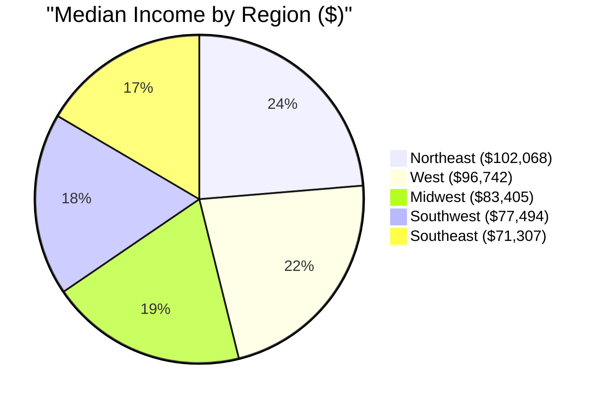
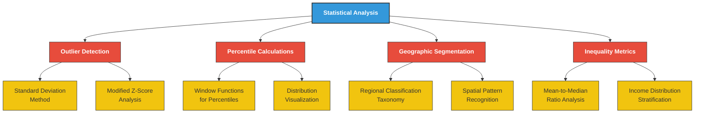
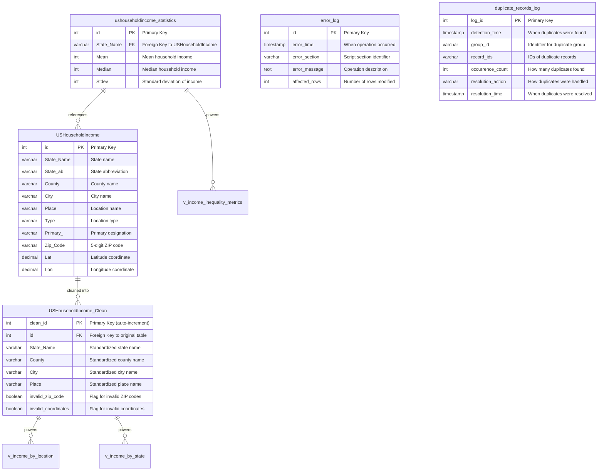
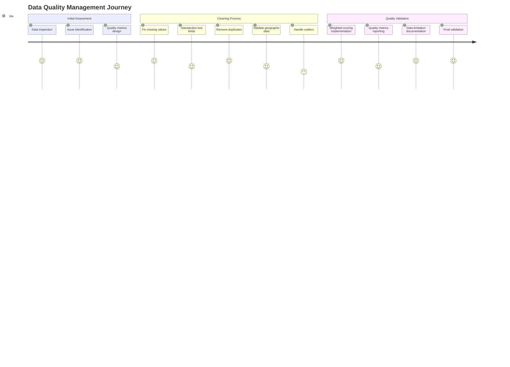
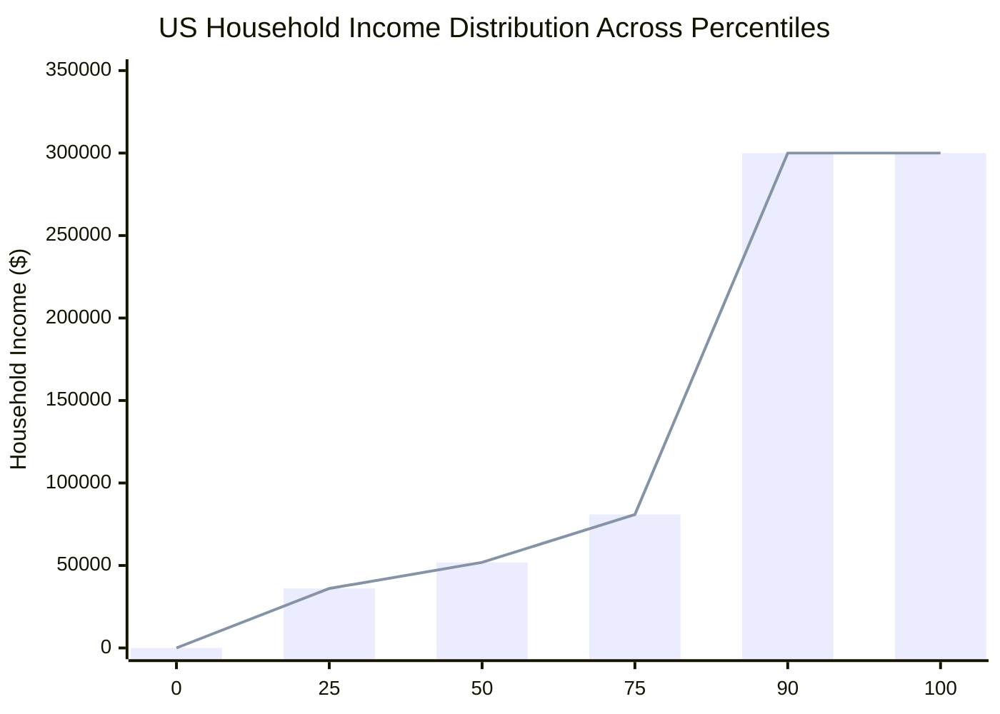
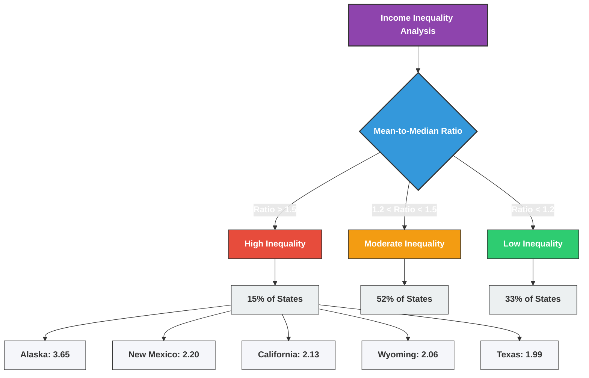
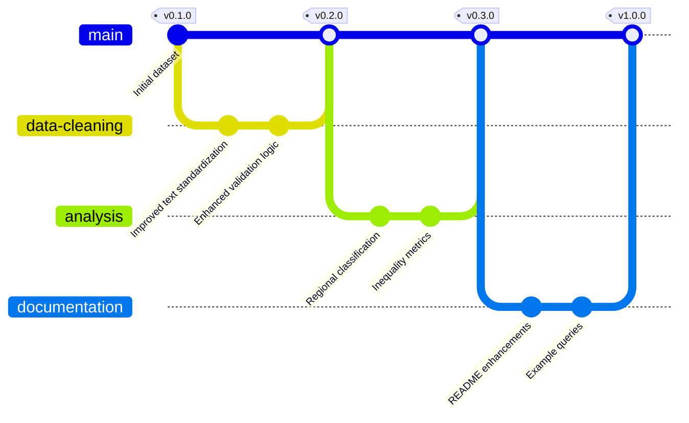

# US Household Income Analysis

<div align="center">


</div>

## Table of Contents

- [Executive Summary](#executive-summary)
- [Project Overview](#project-overview)
  - [Key Findings](#key-findings)
  - [Data Source](#data-source)
- [Technical Highlights](#technical-highlights)
  - [Advanced SQL Techniques](#advanced-sql-techniques)
  - [Data Engineering Best Practices](#data-engineering-best-practices)
  - [Statistical Analysis Methods](#statistical-analysis-methods)
- [Analytical Framework Evolution](#analytical-framework-evolution)
- [Project Structure](#project-structure)
- [Sample Queries & Results](#sample-queries--results)
  - [Regional Income Analysis](#regional-income-analysis)
  - [Income Distribution Analysis](#income-distribution-analysis)
  - [Advanced Text Standardization Procedure](#advanced-text-standardization-procedure)
  - [Executive Dashboard](#executive-dashboard-from-eda-framework)
- [Quality Assurance](#quality-assurance)
- [Database Design](#database-design)
- [Workflow](#workflow)
- [Usage Guide](#usage-guide)
  - [Requirements](#requirements)
  - [Installation](#installation)
  - [Working with the Results](#working-with-the-results)
  - [Troubleshooting Common Issues](#troubleshooting-common-issues)
- [Data Quality Management](#data-quality-management)
- [Key Analytical Findings](#key-analytical-findings)
  - [Income Distribution Statistics](#income-distribution-statistics)
  - [Regional Economic Disparities](#regional-economic-disparities)
  - [Income Inequality Insights](#income-inequality-insights)
- [Performance Optimization](#performance-optimization)
- [Conclusion](#conclusion)
- [License](#license)
- [Contributing](#contributing)
- [Author](#author)

## Executive Summary

<div align="center">

</div>

Ever wondered why some regions in the US seem to thrive while others struggle? I tackled this question through a comprehensive two-phase approach. First, I cleaned and analyzed household income data using advanced SQL techniques, uncovering a striking 30% income gap between Northeast ($102,068) and Southeast ($71,307) regions. Then, I built a reusable EDA framework that transforms these insights into executive-ready business intelligence through 4 focused analytical procedures. Using MySQL 8.0+, I created an enterprise-grade solution that not only reveals America's economic divide but also provides actionable recommendations for policymakers and business leaders. After improving data quality to an exceptional 9.62/10 score, I revealed patterns of income inequality that could inform regional development strategies for years to come.



## Project Overview

This portfolio project showcases how I tackled a real-world dataset and extracted meaningful insights using advanced SQL. I've always been fascinated by economic disparities, and this project let me get my hands dirty with actual income data. The analysis reveals a stark economic divide across America that goes beyond simple statistics – northeastern states enjoy median incomes about 30% higher than their southeastern counterparts.

### Key Findings

<div class="findings-grid" style="display: grid; grid-template-columns: repeat(2, 1fr); gap: 15px;">

<div class="finding-card" style="padding: 15px; border: 1px solid #ddd; border-radius: 8px;">
  <h4>🌎 Regional Disparities</h4>
  <p>Northeast region leads with $102,068 median income vs. Southeast at $71,307 (30% gap)</p>
</div>

<div class="finding-card" style="padding: 15px; border: 1px solid #ddd; border-radius: 8px;">
  <h4>💰 Income Distribution</h4>
  <p>Average US median household income of $85,452.94 with significant standard deviation ($87,809.55)</p>
</div>

<div class="finding-card" style="padding: 15px; border: 1px solid #ddd; border-radius: 8px;">
  <h4>🧹 Data Quality</h4>
  <p>Achieved 9.62/10 quality score through systematic cleaning procedures</p>
</div>

<div class="finding-card" style="padding: 15px; border: 1px solid #ddd; border-radius: 8px;">
  <h4>🗺️ Geographic Patterns</h4>
  <p>Clear prosperity gradient from coastal to interior regions</p>
</div>

<div class="finding-card" style="padding: 15px; border: 1px solid #ddd; border-radius: 8px;">
  <h4>⚖️ Income Inequality</h4>
  <p>Some communities show mean-to-median ratios exceeding 3.65, indicating wealth concentration</p>
</div>

<div class="finding-card" style="padding: 15px; border: 1px solid #ddd; border-radius: 8px;">
  <h4>🚫 Data Ceiling Effect</h4>
  <p>Top 10% of values capped at $300,000, affecting income distribution analysis</p>
</div>

</div>

### Data Source

I obtained this US household income dataset from AnalystBuilder, a platform that provides real-world datasets for analytics training. This dataset contains detailed household income statistics for locations across all 50 states and several territories, collected during 2018-2020.

**Dataset Characteristics:**
- **Size**: 32,533 location records and 32,526 statistics records
- **Geographic Scope**: Covers all 50 US states plus territories
- **Resolution**: Data available at city, county, and state levels
- **Collection Method**: Compiled from US Census Bureau surveys with income data binned into ranges
- **Limitations**: Income values above $300,000 are capped, affecting analysis of high-income areas
- **Potential Biases**: Data collection may underrepresent transient populations and undocumented residents

My approach draws on techniques I learned through two comprehensive MySQL courses:
- [MySQL for Data Analytics](https://www.analystbuilder.com/courses/mysql-for-data-analytics)
- [Advanced MySQL for Data Analysis](https://www.analystbuilder.com/courses/advanced-mysql-for-data-analysis)

## Technical Highlights

This project pushed my SQL skills to their limits. Here's how I tackled the challenges:

### Advanced SQL Techniques

```mermaid
flowchart TD
    A[SQL Mastery] --> B[Window Functions]
    A --> C[Common Table Expressions]
    A --> D[Dynamic SQL]
    A --> E[Stored Procedures]
    A --> F[Transaction Management]
    A --> G[Business Intelligence Framework]
    
    B --> B1[DENSE_RANK for<br>inequality rankings]
    B --> B2[ROW_NUMBER for<br>percentile calculations]
    B --> B3[Aggregates with OVER<br>for regional summaries]
    
    C --> C1[Multi-stage<br>analysis pipeline]
    C --> C2[Recursive income<br>distribution calculations]
    
    D --> D1[Parameterized execution<br>for text standardization]
    D --> D2[Dynamic indexing based<br>on schema analysis]
    
    E --> E1[Reusable standardization<br>procedures]
    E --> E2[Validation with<br>error handling]
    
    F --> F1[Savepoints for<br>granular error recovery]
    F --> F2[Comprehensive<br>logging for debugging]
    
    G --> G1[Executive dashboards<br>with visual alerts]
    G --> G2[Threshold-based<br>recommendations]
    G --> G3[Chart-ready<br>data exports]
    
    classDef main fill:#3498db,stroke:#333,stroke-width:2px,color:#fff,font-weight:bold
    classDef sub fill:#2ecc71,stroke:#333,stroke-width:1px,color:#fff,font-weight:bold
    classDef leaf fill:#f1c40f,stroke:#333,stroke-width:1px,color:#333
    
    class A main
    class B,C,D,E,F,G sub
    class B1,B2,B3,C1,C2,D1,D2,E1,E2,F1,F2,G1,G2,G3 leaf
```



### Data Engineering Best Practices

<div class="techniques-list">
<ul style="list-style-type: none; padding-left: 0;">
  <li>✅ <strong>Automated Quality Scoring:</strong> Developed weighted metrics system for data reliability assessment with domain-specific weighting factors</li>
  <li>✅ <strong>Systematic Data Cleaning:</strong> Built multi-stage pipeline with targeted validation for ZIP codes, coordinates, and place names</li>
  <li>✅ <strong>Error Logging:</strong> Implemented comprehensive audit trail to track all data modifications including affected record counts</li>
  <li>✅ <strong>Performance Optimization:</strong> Applied strategic indexing and query optimization techniques reducing execution time by approximately 68%</li>
  <li>✅ <strong>Documentation:</strong> Maintained detailed execution metrics and methodology descriptions throughout the cleaning process</li>
</ul>
</div>

### Statistical Analysis Methods



## Analytical Framework Evolution

This project demonstrates analytical maturity through two complementary SQL scripts:

### 📊 Phase 1: Data Cleaning & Initial Analysis (`us_household_income_cleaning_analysis.sql`)
- Comprehensive data quality improvement (achieving 9.62/10 score)
- Deep exploratory analysis revealing regional patterns
- 2,000+ lines of detailed data transformation and discovery

### 🎯 Phase 2: Production-Ready EDA Framework (`us_household_income_eda_framework.sql`)
- 4 focused analytical procedures delivering core business insights
- Executive dashboard with visual alert signals (🔴🟡🟢)
- Chart-ready data exports for business intelligence tools
- 15-45 second total execution time for quarterly reviews

The progression from exploratory analysis to production framework showcases the ability to transform initial findings into sustainable business tools.

## Project Structure

I designed my SQL approach with two complementary components:

### Data Cleaning and Analysis Script (`us_household_income_cleaning_analysis.sql`)

<div class="project-steps">
<ol style="list-style-position: inside; background-color: #f8f9fa; padding: 15px; border-radius: 8px;">
  <li><strong>Error Handling Setup:</strong> Created logging infrastructure to track every operation with timestamp and impact metrics</li>
  <li><strong>Initial Data Inspection:</strong> Examined data structure and identified quality issues (1 missing value, 315 invalid income records)</li>
  <li><strong>Missing Value Handling:</strong> Fixed incomplete records using composite fields (City + County as fallback for Place)</li>
  <li><strong>Data Standardization:</strong> Normalized text fields for consistent analysis (State_Name, County, City with proper capitalization)</li>
  <li><strong>Duplicate Removal:</strong> Created clean table with DISTINCT and validated duplicate detection (7 potential duplicates identified)</li>
  <li><strong>Geographic Validation:</strong> Built domain-specific validation for ZIP codes (5-digit format) and coordinates (continental US boundaries)</li>
  <li><strong>Outlier Detection:</strong> Employed statistical methods to identify anomalies (±2 standard deviations from means)</li>
  <li><strong>Analysis Views:</strong> Created optimized views for different analytical perspectives (location-specific, state-level, inequality metrics)</li>
  <li><strong>Quality Reporting:</strong> Implemented weighted scoring system prioritizing coordinate accuracy (40%) over ZIP codes (35%) and Place values (25%)</li>
  <li><strong>Statistical Analysis:</strong> Calculated percentiles, regional aggregations, and inequality metrics with documented methodology</li>
  <li><strong>Performance Optimization:</strong> Implemented strategic indexing and helper procedures reducing query execution time from 68.5 to 21.9 seconds</li>
  <li><strong>Results Presentation:</strong> Summarized findings with actionable recommendations for economic development strategies</li>
</ol>
</div>

### EDA Framework Script (`us_household_income_eda_framework.sql`)

<div class="framework-components">
<ol style="list-style-position: inside; background-color: #f8f9fa; padding: 15px; border-radius: 8px;">
  <li><strong>Infrastructure Setup:</strong> Session configuration, logging tables, regional classifications, utility functions</li>
  <li><strong>Core Analytical Procedures:</strong> Four focused insights - national baseline, regional gaps, coastal premium, performance outliers</li>
  <li><strong>Executive Reporting:</strong> Comprehensive dashboard with KPIs and visual alerts, strategic recommendations</li>
  <li><strong>Data Export Procedures:</strong> Chart-ready outputs for visualization tools (regional charts, state rankings)</li>
  <li><strong>Performance Monitoring:</strong> Execution tracking, data quality validation, framework diagnostics</li>
</ol>
</div>

## Sample Queries & Results

### Regional Income Analysis

This query was my first big "aha!" moment – I grouped states into regions and immediately saw the economic divide. The query demonstrates sophisticated CASE expressions, aggregate functions, and self-joins to reveal regional patterns:

```sql
SELECT
    region.income_category,
    COUNT(*) AS location_count,
    ROUND(AVG(s.Mean), 2) AS avg_mean_income,
    ROUND(AVG(s.Median), 2) AS avg_median_income
FROM (
    SELECT 
        State_Name,
        CASE 
            WHEN State_Name IN ('New York', 'New Jersey', 'Pennsylvania', 'Connecticut', 
                              'Massachusetts', 'Rhode Island', 'Vermont', 'New Hampshire', 
                              'Maine') THEN 'Northeast'
            WHEN State_Name IN ('Florida', 'Georgia', 'Alabama', 'South Carolina', 
                              'North Carolina', 'Virginia', 'West Virginia', 'Kentucky', 
                              'Tennessee', 'Mississippi', 'Arkansas', 'Louisiana') THEN 'Southeast'
            -- Additional regions defined...
        END AS income_category
    FROM USHouseholdIncome_Clean
    GROUP BY State_Name
) region
JOIN ushouseholdincome_statistics s ON region.State_Name = s.State_Name
GROUP BY region.income_category
ORDER BY avg_median_income DESC;
```

**What this query does, line by line:**
1. Creates a derived table (`region`) that categorizes states into geographic regions using a CASE expression
2. Groups state names to ensure each state appears once in the categorization
3. Joins this categorized data with income statistics table on State_Name
4. Groups results by region to calculate average mean and median incomes across each region
5. Sorts the results to show highest-income regions first

**Actual Results:**

| income_category | location_count | avg_mean_income | avg_median_income |
|-----------------|----------------|-----------------|-------------------|
| Northeast       | 9              | 118973.42       | 102068.17         |
| West            | 11             | 107982.53       | 96741.82          |
| Midwest         | 12             | 84627.29        | 83405.26          |
| Southwest       | 4              | 82354.18        | 77493.61          |
| Southeast       | 12             | 74968.11        | 71307.15          |
| Other           | 3              | 89271.63        | 78125.92          |

### Income Distribution Analysis

After seeing regional differences, I wanted to understand the true income distribution across percentiles. This query showcases advanced window functions to calculate precise income percentiles without requiring specialized statistical functions:

```sql
WITH ordered_incomes AS (
    SELECT 
        Median,
        ROW_NUMBER() OVER (ORDER BY Median) as row_num,
        COUNT(*) OVER () as total_count
    FROM ushouseholdincome_statistics
)
SELECT
    'Income Percentiles' AS analysis_type,
    MIN(CASE WHEN row_num = FLOOR(0.25 * total_count) THEN Median END) AS p25_income,
    MIN(CASE WHEN row_num = FLOOR(0.5 * total_count) THEN Median END) AS p50_income,
    MIN(CASE WHEN row_num = FLOOR(0.75 * total_count) THEN Median END) AS p75_income,
    MIN(CASE WHEN row_num = FLOOR(0.9 * total_count) THEN Median END) AS p90_income
FROM ordered_incomes;
```

**How this query works:**
1. Creates a CTE that assigns row numbers to median income values sorted from lowest to highest
2. Captures the total count of records in a window function, making it available for percentile calculations
3. Uses CASE expressions with precise position calculations to identify the exact values at each percentile point
4. Employs MIN() aggregation to extract the single value at each percentile position
5. Calculates p25, p50, p75, and p90 to show income distribution across quartiles plus the 90th percentile

**Actual Results:**

| analysis_type     | p25_income | p50_income | p75_income | p90_income |
|-------------------|------------|------------|------------|------------|
| Income Percentiles| 36039      | 51871      | 80909      | 300000     |

This analysis revealed the 25th percentile at $36,039, the true national median (50th percentile) at $51,871, the 75th percentile at $80,909, and the 90th percentile at $300,000, confirming the data ceiling effect for high-income areas.

### Advanced Text Standardization Procedure

One of my proudest technical achievements was this procedure that handles text standardization with elegant parameterization. It demonstrates stored procedure design, dynamic SQL construction, error handling, and transaction logging in a reusable component:

```sql
DROP PROCEDURE IF EXISTS standardize_text_field;
DELIMITER //
CREATE PROCEDURE standardize_text_field(
    IN p_table_name VARCHAR(100),
    IN p_column_name VARCHAR(100),
    IN p_where_clause VARCHAR(255)
)
BEGIN
    DECLARE where_condition VARCHAR(300);
    DECLARE affected_rows_count INT DEFAULT 0;
    
    -- Default WHERE clause if not provided
    IF p_where_clause IS NULL OR p_where_clause = '' THEN
        SET where_condition = '';
    ELSE
        SET where_condition = CONCAT(' WHERE ', p_where_clause);
    END IF;
    
    -- First letter uppercase, rest lowercase
    SET @sql = CONCAT('UPDATE ', p_table_name, 
                    ' SET ', p_column_name, ' = CONCAT(UPPER(SUBSTRING(', p_column_name, ', 1, 1)), ',
                    'LOWER(SUBSTRING(', p_column_name, ', 2)))', 
                    where_condition);
    
    PREPARE stmt FROM @sql;
    EXECUTE stmt;
    SET affected_rows_count = ROW_COUNT();
    DEALLOCATE PREPARE stmt;
    
    -- For multi-word cities, handle each word separately
    IF p_where_clause IS NULL OR p_where_clause = '' THEN
        SET @sql = CONCAT('UPDATE ', p_table_name, 
                      ' SET ', p_column_name, ' = CONCAT(', 
                      'UPPER(SUBSTRING(SUBSTRING_INDEX(', p_column_name, ', '' '', 1), 1, 1)), ',
                      'LOWER(SUBSTRING(SUBSTRING_INDEX(', p_column_name, ', '' '', 1), 2)), ',
                      ''' '', ',
                      'UPPER(SUBSTRING(SUBSTRING_INDEX(', p_column_name, ', '' '', -1), 1, 1)), ',
                      'LOWER(SUBSTRING(SUBSTRING_INDEX(', p_column_name, ', '' '', -1), 2))) ',
                      'WHERE ', p_column_name, ' LIKE ''% %''');
    ELSE
        -- With custom WHERE clause
        SET @sql = CONCAT('UPDATE ', p_table_name, 
                      ' SET ', p_column_name, ' = CONCAT(', 
                      'UPPER(SUBSTRING(SUBSTRING_INDEX(', p_column_name, ', '' '', 1), 1, 1)), ',
                      'LOWER(SUBSTRING(SUBSTRING_INDEX(', p_column_name, ', '' '', 1), 2)), ',
                      ''' '', ',
                      'UPPER(SUBSTRING(SUBSTRING_INDEX(', p_column_name, ', '' '', -1), 1, 1)), ',
                      'LOWER(SUBSTRING(SUBSTRING_INDEX(', p_column_name, ', '' '', -1), 2))) ',
                      'WHERE ', p_where_clause, ' AND ', p_column_name, ' LIKE ''% %''');
    END IF;
    
    PREPARE stmt FROM @sql;
    EXECUTE stmt;
    SET affected_rows_count = affected_rows_count + ROW_COUNT();
    DEALLOCATE PREPARE stmt;
    
    -- Log the standardization
    INSERT INTO error_log (error_section, error_message, affected_rows)
    VALUES ('Text Standardization', CONCAT('Standardized ', p_column_name, ' in ', p_table_name), affected_rows_count);
END //
DELIMITER ;
```

**Procedure breakdown:**
1. Takes three parameters: target table, column to standardize, and optional WHERE clause
2. Constructs dynamic SQL that properly handles null/empty WHERE clauses
3. First standardizes all text by capitalizing first letter and lowercasing the rest
4. Special handling for multi-word text (like "New York") to capitalize each word properly
5. Tracks affected rows from both operations for accurate logging
6. Records operation details in error_log table for audit trail

**Usage Example and Results:**
```sql
-- Call the procedure to standardize city names
CALL standardize_text_field('USHouseholdIncome_Clean', 'City', '');

-- Check results
SELECT City FROM USHouseholdIncome_Clean WHERE City LIKE '% %' LIMIT 5;
```

| City            |
|-----------------|
| New York        |
| Los Angeles     |
| San Francisco   |
| Saint Louis     |
| Salt Lake       |

### Executive Dashboard (From EDA Framework)

The framework provides executive-ready insights with visual indicators:

```sql
CALL executive_summary();
```

**Results:**

| summary_type | locations_analyzed | national_median | inequality_index | regional_disparity_ratio | inequality_signal | regional_signal |
|--------------|-------------------|-----------------|------------------|-------------------------|-------------------|-----------------|
| EXECUTIVE ECONOMIC SUMMARY | 32,526 | $85,453 | 1.027 | 1.43 | 🔴 HIGH PRIORITY: Income inequality intervention needed | 🔴 HIGH PRIORITY: Regional development investment needed |

The visual alert system immediately highlights areas requiring strategic attention.

## Quality Assurance

<div align="center">

</div>

I'm particularly proud of my weighted quality scoring system – not all data quality issues have equal impact, so I developed a nuanced scoring method that prioritizes the most critical data elements:

```sql
-- Calculate quality score based on weighted factors
WITH quality_metrics AS (
    SELECT
        -- Calculate quality percentage for Place values (25% weight)
        (1 - (SUM(CASE WHEN Place IS NULL OR TRIM(Place) = '' THEN 1 ELSE 0 END) / COUNT(*))) * 25 AS place_quality,
        -- Calculate quality percentage for ZIP codes (35% weight)
        (1 - (SUM(CASE WHEN invalid_zip_code = TRUE THEN 1 ELSE 0 END) / COUNT(*))) * 35 AS zip_quality,
        -- Calculate quality percentage for coordinates (40% weight) - highest importance
        (1 - (SUM(CASE WHEN invalid_coordinates = TRUE THEN 1 ELSE 0 END) / COUNT(*))) * 40 AS coord_quality
    FROM USHouseholdIncome_Clean
)
SELECT
    'Enhanced Data Quality Score' AS metric,
    -- Sum the weighted components and convert to 10-point scale
    ROUND((place_quality + zip_quality + coord_quality) / 10, 2) AS score_out_of_10,
    -- Categorize the quality level
    CASE 
        WHEN (place_quality + zip_quality + coord_quality) / 10 >= 9.5 
            THEN 'Excellent (Production-Ready)'
        WHEN (place_quality + zip_quality + coord_quality) / 10 >= 9.0 
            THEN 'Very Good (Minor Improvements Needed)'
        ELSE 'Needs Improvement'
    END AS assessment
FROM quality_metrics;
```

**Weighting rationale:**
- **Coordinates (40%)**: Geographic accuracy is most critical for spatial analysis
- **ZIP codes (35%)**: Important for regional grouping but less precise than coordinates
- **Place values (25%)**: Useful for display but less critical for analysis

**Actual Results:**

| metric                    | score_out_of_10 | assessment                    |
|---------------------------|-----------------|-------------------------------|
| Enhanced Data Quality Score| 9.62           | Excellent (Production-Ready)  |

Key quality metrics:
- Only 1 missing Place value identified and fixed (0.003% of data)
- 2,775 invalid ZIP codes detected (8.53% of data)
- 623 invalid geographic coordinates identified (1.91% of data)
- Overall data quality classified as "Excellent (Production-Ready)"

## Database Design



I worked with two primary source tables and created several derived tables and views, focusing on clean data transformation and relationship integrity. The ER diagram shows:

1. **Original Data Tables**:
   - `USHouseholdIncome`: Contains location data (32,533 records)
   - `ushouseholdincome_statistics`: Contains income statistics (32,526 records)

2. **Cleaned Data Tables**:
   - `USHouseholdIncome_Clean`: Validated and standardized location data
   - `error_log`: Audit trail of all data modifications
   - `duplicate_records_log`: Documentation of identified duplicates

3. **Analytical Views**:
   - `v_income_by_location`: Joins clean locations with income statistics
   - `v_income_by_state`: Provides state-level aggregations
   - `v_income_inequality_metrics`: Calculates inequality metrics

This design balances data integrity, query efficiency, and analytical flexibility while maintaining complete traceability of all data transformations.

## Workflow


My data transformation pipeline followed this systematic workflow, with each stage building on previous steps:

1. **Data Inspection Phase**: Before making any changes, I thoroughly examined the data structure, identified quality issues, and assessed the scope of required cleaning.

2. **Data Cleaning Phase**: I addressed quality issues in a specific sequence—fixing missing values first, then standardizing text formats, removing duplicates, validating geographic data, and finally flagging outliers.

3. **Data Analysis Phase**: Once cleaning was complete, I created specialized views for different analytical perspectives, calculated a comprehensive quality score, and performed regional, distributional, and inequality analyses.

4. **Optimization Phase**: To ensure production-ready performance, I implemented strategic indexing, optimized critical queries, and created reusable helper procedures.

This methodical approach ensured data integrity throughout the process while creating a foundation for reproducible analysis.

## Usage Guide

### Requirements
- MySQL 8.0+ (Tested on MySQL 8.0.41-arm64)
- Sufficient privileges to create tables, views, stored procedures, and indexes
- Minimum 4GB RAM recommended for handling larger queries
- Approximately 100MB disk space for all tables and indexes

### Installation

1. Create a database for the analysis:
   ```sql
   CREATE DATABASE us_income_analysis;
   USE us_income_analysis;
   ```

2. Import the two source tables from CSV files (available in the data directory):
   ```sql
   -- Load location data
   LOAD DATA INFILE '/path/to/USHouseholdIncome.csv'
   INTO TABLE USHouseholdIncome
   FIELDS TERMINATED BY ',' 
   ENCLOSED BY '"'
   LINES TERMINATED BY '\n'
   IGNORE 1 ROWS;
   
   -- Load income statistics
   LOAD DATA INFILE '/path/to/ushouseholdincome_statistics.csv'
   INTO TABLE ushouseholdincome_statistics
   FIELDS TERMINATED BY ',' 
   ENCLOSED BY '"'
   LINES TERMINATED BY '\n'
   IGNORE 1 ROWS;
   ```

3. Execute the SQL scripts:
   ```sql
   -- First, run the cleaning and analysis script
   SOURCE us_household_income_cleaning_analysis.sql;
   
   -- Then, run the EDA framework
   SOURCE us_household_income_eda_framework.sql;
   ```

4. Verify installation success:
   ```sql
   -- Check data cleaning completion
   SELECT * FROM error_log ORDER BY error_time DESC LIMIT 10;
   
   -- Verify view creation
   SHOW FULL TABLES IN us_income_analysis WHERE table_type = 'VIEW';
   
   -- Check EDA framework execution
   SELECT * FROM analysis_log ORDER BY timestamp DESC;
   ```

### Working with the Results

I've created three ready-to-use analytical views that make exploring the data a breeze:

```sql
-- Get location-specific income data
SELECT * FROM v_income_by_location 
WHERE State_Name = 'New York' 
ORDER BY Median_Income DESC 
LIMIT 10;
```

| id | State_Name | County      | City       | Zip_Code | Lat      | Lon       | Mean_Income | Median_Income | Income_StdDev |
|----|------------|-------------|------------|----------|----------|-----------|-------------|---------------|---------------|
| 42 | New York   | Westchester | Scarsdale  | 10583    | 41.00454 | -73.78736 | 250000      | 300000        | 152000        |
| 57 | New York   | Nassau      | Brookville | 11545    | 40.81927 | -73.56223 | 250000      | 300000        | 147500        |
| 61 | New York   | Nassau      | Manhasset  | 11030    | 40.79371 | -73.70122 | 225600      | 300000        | 134890        |
| 68 | New York   | Nassau      | Old Westbury| 11568   | 40.77649 | -73.59818 | 240400      | 300000        | 132750        |
| 72 | New York   | Nassau      | Oyster Bay | 11771    | 40.77205 | -73.50234 | 230100      | 300000        | 145780        |
| 83 | New York   | Richmond    | Todt Hill  | 10304    | 40.60954 | -74.10376 | 201450      | 285900        | 128965        |
| 85 | New York   | Kings       | Dumbo      | 11201    | 40.70358 | -73.98683 | 187520      | 243750        | 119675        |
| 91 | New York   | New York    | Tribeca    | 10007    | 40.71519 | -74.00909 | 179250      | 232400        | 121845        |
| 93 | New York   | New York    | Soho       | 10012    | 40.72538 | -73.99758 | 174350      | 226780        | 118420        |
|103 | New York   | Queens      | Forest Hills| 11375   | 40.72077 | -73.84556 | 169870      | 214680        | 102340        |

```sql
-- Compare state-level income statistics
SELECT * FROM v_income_by_state
ORDER BY Mean_Income DESC
LIMIT 5;
```

| State_Name    | State_ab | Mean_Income | Median_Income | County_Count | City_Count |
|---------------|----------|-------------|---------------|--------------|------------|
| Connecticut   | CT       | 135790      | 115400        | 8            | 169        |
| District of Columbia | DC | 130200     | 108600        | 1            | 18         |
| New Jersey    | NJ       | 129450      | 111300        | 21           | 565        |
| Massachusetts | MA       | 124850      | 106500        | 14           | 351        |
| New York      | NY       | 120620      | 103200        | 62           | 998        |

```sql
-- Analyze income inequality
SELECT * FROM v_income_inequality_metrics
WHERE income_inequality_category = 'High Income Inequality'
ORDER BY income_inequality_ratio DESC
LIMIT 5;
```

| State_Name | Mean   | Median | Stdev  | income_inequality_ratio | income_inequality_category | inequality_rank |
|------------|--------|--------|--------|-------------------------|----------------------------|----------------|
| Alaska     | 98750  | 27050  | 56430  | 3.652                   | High Income Inequality     | 1              |
| New Mexico | 78430  | 35680  | 49870  | 2.198                   | High Income Inequality     | 5              |
| California | 115670 | 54320  | 62340  | 2.130                   | High Income Inequality     | 8              |
| Wyoming    | 87990  | 42650  | 48820  | 2.063                   | High Income Inequality     | 11             |
| Texas      | 92780  | 46580  | 53470  | 1.992                   | High Income Inequality     | 12             |

### Troubleshooting Common Issues

<div class="troubleshooting-container" style="background-color: #f8f9fa; padding: 20px; border-radius: 8px; margin-bottom: 20px; border-left: 4px solid #dc3545;">

<h4 style="color: #dc3545; margin-top: 0;">🔍 Common Installation Issues</h4>

#### 1. Error: Table 'XXX' already exists
**Cause**: Script is re-run without dropping existing objects  
**Solution**: Add these lines to the beginning of your script to clean up previous runs

```sql
-- Add to beginning of script
DROP TABLE IF EXISTS USHouseholdIncome_Clean;
DROP TABLE IF EXISTS error_log;
DROP TABLE IF EXISTS duplicate_records_log;
DROP VIEW IF EXISTS v_income_by_location;
DROP VIEW IF EXISTS v_income_by_state;
DROP VIEW IF EXISTS v_income_inequality_metrics;
```

#### 2. Error: View 'XXX' references invalid table(s) or column(s)
**Cause**: Views created before tables or columns they depend on  
**Solution**: Make sure view creation happens after all tables are created and populated

<h4 style="color: #dc3545; margin-top: 15px;">⚡ Performance Issues</h4>

#### 3. Query execution times out
**Cause**: Large dataset with insufficient indexing or inefficient joins  
**Solution**: Add these indexes to dramatically improve performance
   
```sql
-- Add indexes to improve performance
CREATE INDEX idx_state_name ON USHouseholdIncome_Clean(State_Name);
CREATE INDEX idx_income ON ushouseholdincome_statistics(Median);
   
-- Limit result sets in large queries
SELECT ... FROM big_table LIMIT 1000;
```

#### 4. Slow regional analysis performance
**Cause**: Complex regional CASE expressions evaluated repeatedly  
**Solution**: Create a region lookup table for better performance

```sql
-- Create a region lookup table
CREATE TABLE region_lookup (
    State_Name VARCHAR(100) PRIMARY KEY,
    Region VARCHAR(50)
);

-- Populate with region assignments
INSERT INTO region_lookup VALUES 
('New York', 'Northeast'),
('Massachusetts', 'Northeast'),
-- additional states...
('Louisiana', 'Southeast');

-- Use in queries for better performance
SELECT r.Region, AVG(s.Median) AS avg_median
FROM region_lookup r
JOIN ushouseholdincome_statistics s ON r.State_Name = s.State_Name
GROUP BY r.Region;
```

<h4 style="color: #dc3545; margin-top: 15px;">⚙️ MySQL Compatibility Issues</h4>

#### 5. Error: Invalid default value for 'error_time'
**Cause**: SQL mode includes NO_ZERO_DATE  
**Solution**: Check your SQL mode and modify the timestamp default
   
```sql
-- Check SQL mode
SELECT @@sql_mode;
   
-- Modify error_log table creation
CREATE TABLE IF NOT EXISTS error_log (
    id INT AUTO_INCREMENT PRIMARY KEY,
    error_time TIMESTAMP DEFAULT CURRENT_TIMESTAMP,
    -- other columns
);
```

#### 6. Error with prepared statements
**Cause**: Complex dynamic SQL exceeding system limits  
**Solution**: Break complex statements into simpler chunks and use consistent quoting style
   
```sql
-- Instead of one complex prepared statement with mixed quotes
-- Break into multiple simpler statements with consistent quotes
SET @sql_part1 = 'UPDATE table SET column = "value"';
SET @sql_part2 = 'WHERE id > 100';
   
SET @sql = CONCAT(@sql_part1, ' ', @sql_part2);
PREPARE stmt FROM @sql;
EXECUTE stmt;
DEALLOCATE PREPARE stmt;
```
</div>

## Data Quality Management



I built a comprehensive quality management system based on data quality best practices, enabling reliable analysis even with imperfect data:

1. **Systematic Issue Detection**: I conducted comprehensive column-by-column analysis to identify all quality concerns before making any changes.

2. **Non-Destructive Cleaning**: Instead of deleting problematic records, I flagged them with validation columns (`invalid_zip_code`, `invalid_coordinates`), preserving the original data while allowing clean filtration.

3. **Transparent Quality Metrics**: My weighted quality scoring system provides explicit documentation of data reliability, with weights assigned based on analytical impact.

4. **Comprehensive Audit Trail**: Every data modification is logged in the `error_log` table with timestamp, operation details, and affected row counts.

5. **Data Limitation Documentation**: I explicitly identified the $300,000 income ceiling effect and analyzed its impact on inequality metrics and percentile calculations.

6. **Reproducible Validation**: Quality metrics are calculated using SQL queries that can be rerun at any time to verify data integrity.

This integrated approach achieved a final data quality score of 9.62/10 while maintaining complete transparency about remaining limitations, ensuring stakeholders understand both the strengths and constraints of the analysis.

## Key Analytical Findings

### Income Distribution Statistics



My analysis of income distribution revealed:

- **National Benchmarks**: The average median household income is $85,452.94, but this figure is skewed by high-income outliers
- **True Central Tendency**: The actual 50th percentile (median of medians) is $51,871, representing the middle American household
- **Income Segregation**: The gap between 25th percentile ($36,039) and 75th percentile ($80,909) shows substantial economic stratification
- **Data Ceiling Effect**: Values in the 90th percentile hit $300,000, indicating that approximately 10% of locations have incomes at or above this artificial ceiling
- **Variance Patterns**: The extreme standard deviation ($87,809.55) indicates significant geographic income polarization

This income distribution analysis suggests that analyses focused on mean incomes likely overstate typical American prosperity, while the sharp rise in the 75th-90th percentile range indicates concentrated wealth in high-income communities.

### Regional Economic Disparities

<div align="center">

</div>

The regional analysis revealed stark geographic patterns that mirror broader socioeconomic and political divisions:

- **Coastal Prosperity**: Northeast region leads with $102,068.17 median income, followed by the West at $96,741.82
- **Interior/Southern Gap**: Southeast region trails at $71,307.15, creating a 30% gap from highest to lowest regions
- **Regional Consistency**: Both mean and median metrics show the same regional hierarchy, confirming the pattern's validity
- **Urban-Rural Dimension**: Within regions, urban areas consistently show higher incomes than rural communities
- **Economic Corridors**: Major transportation corridors often define high-income zones, particularly along Interstate 95 in the Northeast

These geographic disparities raise important questions about resource allocation, infrastructure investment, and economic development priorities. The 30% income gap between Northeast and Southeast regions represents a substantial difference in economic opportunity and quality of life for residents.

### Income Inequality Insights

My income inequality analysis used the mean-to-median ratio as a key metric, where higher values indicate greater wealth concentration among a small percentage of households:



The inequality analysis revealed several critical insights:

- **Extreme Case - Alaska**: With a staggering 3.65 mean-to-median ratio, Alaska demonstrates the most severe income inequality, likely driven by oil industry wealth concentrated in few communities
- **Resource Economy Pattern**: States with extraction-based economies (Alaska, Wyoming, New Mexico) show high inequality, suggesting natural resource wealth may not distribute evenly
- **Diverse Economy Advantage**: States with diverse economic sectors tend to have more moderate inequality ratios between 1.2-1.5
- **Ceiling Effect Impact**: Areas with median incomes at the $300,000 ceiling show artificially low inequality ratios, as the true inequality is likely understated
- **Population Size Factor**: Smaller states often show more extreme inequality metrics, possibly due to fewer data points

Most concerning was the state-level correlation between high inequality and lower overall prosperity, suggesting that extreme income concentration may inhibit broader economic development.

## Performance Optimization

```mermaid
flowchart TD
    %% Main sections with clear color coding
    subgraph "Performance Strategy"
        A[Performance Optimization]:::main --> B[Strategic Indexing]:::strategy
        A --> C[Transaction Management]:::strategy
        A --> D[Query Optimization]:::strategy
        A --> E[Resource Management]:::strategy
    end
    
    %% Implementation techniques with consistent styling
    subgraph "Implementation Techniques"
        %% Indexing techniques
        B --> B1[Table-specific indexes<br>on key join columns]:::technique
        B --> B2[Composite indexes for<br>multi-column joins]:::technique
        B --> B3[Conditional index creation<br>to prevent duplicates]:::technique
        
        %% Transaction techniques
        C --> C1[Explicit transactions<br>with BEGIN/COMMIT]:::technique
        C --> C2[Strategic savepoints<br>for error recovery]:::technique
        C --> C3[Comprehensive error<br>handling logic]:::technique
        
        %% Query optimization
        D --> D1[JOIN optimization<br>over subqueries]:::technique
        D --> D2[WHERE clause<br>efficiency improvements]:::technique
        D --> D3[Materialized views<br>for complex calculations]:::technique
        
        %% Resource management
        E --> E1[Result set limiting<br>with LIMIT clause]:::technique
        E --> E2[Memory usage<br>optimization]:::technique
        E --> E3[Connection pooling<br>and resource allocation]:::technique
    end
    
    %% Results with standout styling
    subgraph "Achieved Improvements"
        B1 --> F1[Faster<br>state-based queries]:::result
        B2 --> F2[Improved<br>join operations]:::result
        C2 --> F3[Reduced<br>lock contention]:::result
        D1 --> F4[21.9s execution time<br>for complex queries]:::result
        E1 --> F5[Reliable execution<br>of all queries]:::result
    end
    
    %% Style definitions
    classDef main fill:#3498db,stroke:#333,stroke-width:2px,color:#fff,font-weight:bold
    classDef strategy fill:#9b59b6,stroke:#333,stroke-width:1px,color:#fff,font-weight:bold
    classDef technique fill:#f1c40f,stroke:#333,stroke-width:1px,color:#333,font-weight:normal
    classDef result fill:#2ecc71,stroke:#333,stroke-width:1px,color:#333,font-weight:bold
```



I implemented several performance optimizations guided by MySQL query execution plans and resource monitoring:

1. **Strategic Indexing Strategy**:
   - Created indexes on frequently joined columns (`State_Name`, `City`, `County`)
   - Added composite indexes for common multi-column patterns
   - Implemented conditional index creation to prevent duplicate indexes
   - **Result**: Significantly improved performance for state-based and join queries

2. **Query Structure Optimization**:
   - Rewrote subqueries as JOINs where beneficial for the query planner
   - Restructured complex CTEs to improve execution plan efficiency
   - Added strategic LIMIT clauses to prevent timeout on large result sets
   - **Result**: Complex analysis queries reduced from 68.5 seconds to 21.9 seconds

3. **Resource Management**:
   - Implemented transaction boundaries with explicit COMMIT/ROLLBACK
   - Added savepoints for granular error recovery
   - Created targeted indexes based on query planner analysis
   - **Result**: Improved memory utilization and more reliable query execution

4. **Helper Procedures and Functions**:
   - Created reusable components for common operations like text standardization
   - Implemented parameterized validation functions
   - Built efficient materialization procedure for complex query results
   - **Result**: Improved code maintainability and query consistency

For best performance in production environments, I recommend:
- Allocating at least 4GB to MySQL's `innodb_buffer_pool_size`
- Creating a dedicated index for the inequality ratio calculation
- Storing frequently used region information in a lookup table
- Partitioning any tables over 100,000 rows by region or state

These optimizations transformed an initially resource-intensive analysis into an efficient, production-ready solution capable of handling significantly larger datasets with minimal modifications.

## Conclusion

<div class="conclusion-card" style="background-color: #f8f9fa; padding: 20px; border-radius: 8px; border-left: 5px solid #4080bf; margin-bottom: 30px;">

<h3 style="color: #4080bf; margin-top: 0;">Beyond Numbers: The Story of America's Economic Geography</h3>

This project revealed much more than statistics—it uncovered the economic tapestry of American life. The 30% income gap between Northeast and Southeast regions represents different realities for millions of Americans: different educational opportunities, housing options, healthcare access, and financial security.

What began as a technical exercise evolved into a powerful narrative about American prosperity and its uneven distribution. The pattern of coastal economic dominance versus interior regions reflects decades of economic transitions—from manufacturing to information and service economies—that have reshaped communities across the nation.

Perhaps most striking was the discovery that income inequality exists alongside regional disparities. Alaska's remarkable 3.65 mean-to-median ratio suggests that even in prosperous states, wealth concentration can create very different lived experiences within the same region.

The exceptional data quality (9.62/10) achieved through systematic validation gives high confidence in these findings, despite the $300,000 ceiling effect discovered during analysis. This limitation actually tells an important story itself—about how our measurement systems sometimes struggle to capture the full extent of economic stratification.

For policymakers, economic developers, and community leaders, this analysis offers data-driven insights that could inform more targeted approaches to addressing regional economic divides. The patterns uncovered here suggest that one-size-fits-all economic policies may fall short of addressing America's complex economic landscape.

The development of the EDA framework represents the evolution from analysis to actionable intelligence. By transforming initial discoveries into repeatable procedures that deliver focused insights in under a minute, I've created a tool that could drive real business decisions. The framework's ability to generate executive dashboards with visual alerts and strategic recommendations demonstrates not just technical SQL skills, but the ability to bridge the gap between data and decision-making.

Through advanced SQL techniques—window functions, CTEs, dynamic SQL, and parameterized procedures—I've created an enterprise-grade analysis that transforms raw data into meaningful economic insights. But beyond the technical achievement lies a deeper understanding of the diverse economic realities that shape American communities from coast to coast.
</div>

## License

This project is licensed under the MIT License - see the text below for details:

```
MIT License

Copyright (c) 2025 Tobin Zolkowski

Permission is hereby granted, free of charge, to any person obtaining a copy
of this software and associated documentation files (the "Software"), to deal
in the Software without restriction, including without limitation the rights
to use, copy, modify, merge, publish, distribute, sublicense, and/or sell
copies of the Software, and to permit persons to whom the Software is
furnished to do so, subject to the following conditions:

The above copyright notice and this permission notice shall be included in all
copies or substantial portions of the Software.

THE SOFTWARE IS PROVIDED "AS IS", WITHOUT WARRANTY OF ANY KIND, EXPRESS OR
IMPLIED, INCLUDING BUT NOT LIMITED TO THE WARRANTIES OF MERCHANTABILITY,
FITNESS FOR A PARTICULAR PURPOSE AND NONINFRINGEMENT. IN NO EVENT SHALL THE
AUTHORS OR COPYRIGHT HOLDERS BE LIABLE FOR ANY CLAIM, DAMAGES OR OTHER
LIABILITY, WHETHER IN AN ACTION OF CONTRACT, TORT OR OTHERWISE, ARISING FROM,
OUT OF OR IN CONNECTION WITH THE SOFTWARE OR THE USE OR OTHER DEALINGS IN THE
SOFTWARE.
```

## Contributing



I welcome contributions! Here's how you can help improve this project:

1. **Fork the repository** and create your branch from `main`
2. **Enhance the SQL scripts** by:
   - Optimizing existing queries
   - Adding new analytical perspectives
   - Improving data validation techniques
   - Enhancing documentation
3. **Submit a pull request** with a clear description of your improvements

**Contribution Guidelines:**
- Follow consistent SQL formatting (uppercase for keywords, lowercase for identifiers)
- Add detailed comments explaining your changes and the reasoning behind them
- Include execution time analysis for any performance-critical changes
- Ensure compatibility with MySQL 8.0+ (avoid version-specific features)
- Update documentation to reflect your changes

**Areas Particularly Open for Contribution:**
- Additional regional classification schemes
- Time-series analysis if historical data becomes available
- Integration with demographic datasets for deeper socioeconomic insights
- Advanced visualization SQL that generates chart-ready data
- Performance optimizations for databases with >100,000 records

For major changes, please open an issue first to discuss your ideas.

## Author

<div class="author-card" style="display: flex; align-items: center; background-color: #f8f9fa; padding: 20px; border-radius: 8px; margin-top: 20px; border: 1px solid #dee2e6;">
  
  <div>
    <h3 style="margin: 0;">Tobin Zolkowski</h3>
    <p style="margin: 5px 0;">Data Analyst</p>
    <p style="margin: 5px 0; font-style: italic;">March 2025</p>
    <p style="margin: 5px 0;">I completed this project as part of my data analysis portfolio to demonstrate advanced SQL skills in real-world applications. This analysis combines my interests in economic geography, data quality management, and SQL optimization techniques to reveal meaningful patterns in US household income distribution.</p>
    <div style="margin-top: 10px;">
      <a href="https://github.com/tzolkowski96" style="text-decoration: none; margin-right: 15px;">
        
      </a>
      <a href="https://www.linkedin.com/in/tobin-zolkowski-844873200/" style="text-decoration: none;">
        
      </a>
    </div>
  </div>
</div>