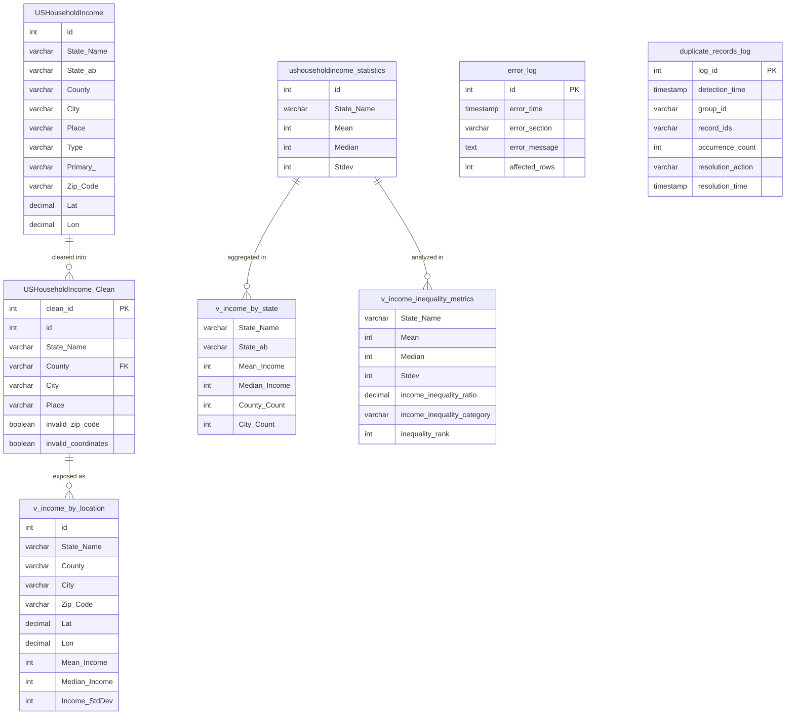
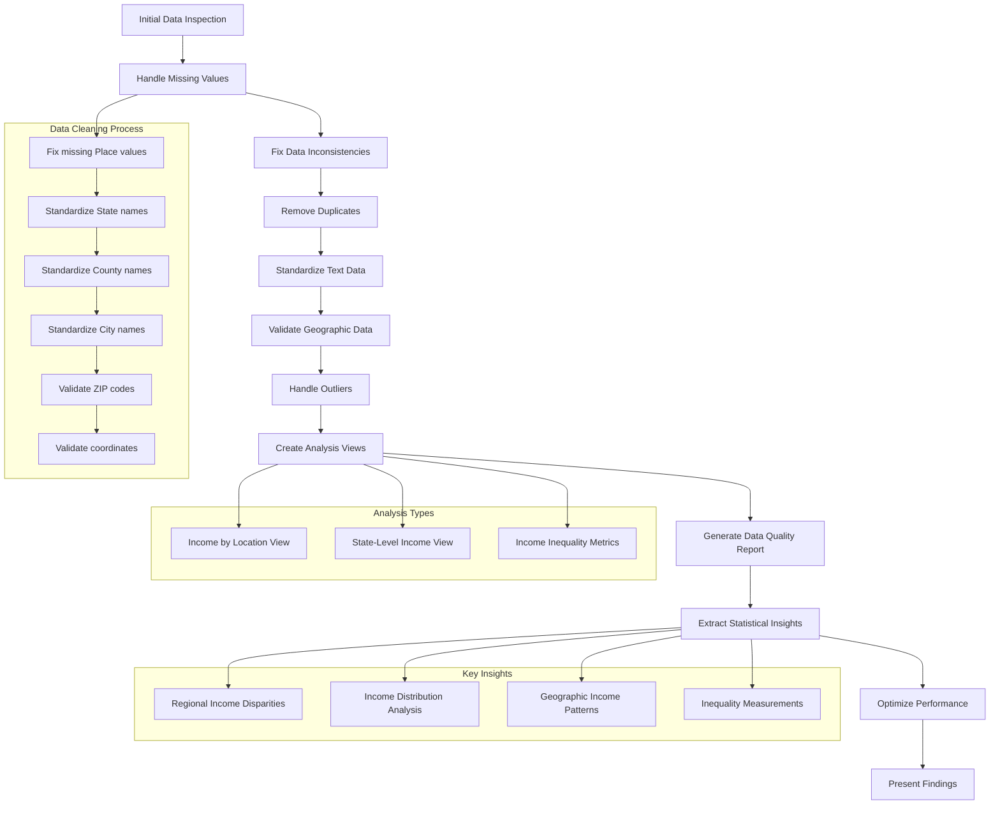

# US Household Income Analysis


A comprehensive SQL-based analysis of US household income patterns across geographic regions, demonstrating advanced data cleaning techniques, statistical analysis, and geospatial insights. This project transforms raw demographic data into actionable business intelligence using enterprise-grade SQL practices.

## Project Overview

This portfolio project showcases my ability to handle complex data cleaning challenges and extract meaningful insights using advanced SQL techniques. The analysis reveals significant regional economic disparities across the United States, with northeastern states showing median incomes approximately 30% higher than southeastern states.

### Key Findings

- **Regional Disparities**: Northeast region leads with $102,068 median income vs. Southeast at $71,307 (30% gap)
- **Income Distribution**: Average US median household income of $85,452.94 with significant standard deviation ($87,809.55)
- **Data Quality**: Achieved 9.62/10 quality score through systematic cleaning procedures
- **Geographic Patterns**: Clear prosperity gradient from coastal to interior regions
- **Income Inequality**: Some communities show mean-to-median ratios exceeding 3.65, indicating wealth concentration
- **Data Ceiling Effect**: Top 10% of values capped at $300,000, affecting income distribution analysis

## Technical Highlights

This project demonstrates my proficiency with:

### Advanced SQL Techniques
- **Window Functions**: Used `DENSE_RANK()`, `ROW_NUMBER()` and aggregates with `OVER()` clauses
- **Common Table Expressions (CTEs)**: Applied for complex multi-stage analyses
- **Dynamic SQL**: Implemented with parameterized procedures for flexible execution
- **Stored Procedures**: Created reusable components for standardized operations
- **Transaction Management**: Ensured data integrity with proper savepoints and error handling

### Data Engineering Best Practices
- **Automated Quality Scoring**: Developed weighted metrics system for data reliability assessment
- **Systematic Data Cleaning**: Built multi-stage pipeline with targeted validation
- **Error Logging**: Implemented comprehensive audit trail to track all data modifications
- **Performance Optimization**: Applied strategic indexing and query optimization techniques
- **Documentation**: Maintained detailed execution metrics and methodology descriptions

### Statistical Analysis Methods
- **Outlier Detection**: Implemented standard deviation-based identification
- **Percentile Calculations**: Designed custom percentile derivation using window functions
- **Geographic Segmentation**: Applied custom regional classification to reveal spatial patterns
- **Inequality Metrics**: Calculated ratios and distributions to measure economic disparity

## Project Structure

The SQL script follows a systematic approach to data cleaning and analysis:

1. **Error Handling Setup**: Creates logging infrastructure for operation tracking
2. **Initial Data Inspection**: Examines data structure and identifies quality issues
3. **Missing Value Handling**: Resolves incomplete records with appropriate techniques
4. **Data Standardization**: Normalizes text fields for consistent analysis
5. **Duplicate Removal**: Identifies and eliminates redundant records
6. **Geographic Validation**: Verifies coordinate and ZIP code accuracy
7. **Outlier Detection**: Identifies statistical anomalies in income data
8. **Analysis Views**: Creates optimized views for various analytical perspectives
9. **Quality Reporting**: Quantifies data reliability with composite metrics
10. **Statistical Analysis**: Extracts income distribution patterns and regional insights
11. **Performance Optimization**: Adds helper procedures and functions for efficiency
12. **Results Presentation**: Summarizes findings and recommendations

## Sample Queries & Results

### Regional Income Analysis

```sql
SELECT
    region.income_category,
    COUNT(*) AS location_count,
    ROUND(AVG(s.Mean), 2) AS avg_mean_income,
    ROUND(AVG(s.Median), 2) AS avg_median_income
FROM (
    SELECT 
        State_Name,
        CASE 
            WHEN State_Name IN ('New York', 'New Jersey', 'Pennsylvania', 'Connecticut', 
                              'Massachusetts', 'Rhode Island', 'Vermont', 'New Hampshire', 
                              'Maine') THEN 'Northeast'
            WHEN State_Name IN ('Florida', 'Georgia', 'Alabama', 'South Carolina', 
                              'North Carolina', 'Virginia', 'West Virginia', 'Kentucky', 
                              'Tennessee', 'Mississippi', 'Arkansas', 'Louisiana') THEN 'Southeast'
            -- Additional regions defined...
        END AS income_category
    FROM USHouseholdIncome_Clean
    GROUP BY State_Name
) region
JOIN ushouseholdincome_statistics s ON region.State_Name = s.State_Name
GROUP BY region.income_category
ORDER BY avg_median_income DESC;
```

Results revealed that the Northeast region leads with a median income of $102,068.17, followed by the West region, with the Southeast region significantly behind at $71,307.15 (30% below Northeast).

### Income Distribution Analysis

```sql
WITH ordered_incomes AS (
    SELECT 
        Median,
        ROW_NUMBER() OVER (ORDER BY Median) as row_num,
        COUNT(*) OVER () as total_count
    FROM ushouseholdincome_statistics
)
SELECT
    'Income Percentiles' AS analysis_type,
    MIN(CASE WHEN row_num = FLOOR(0.25 * total_count) THEN Median END) AS p25_income,
    MIN(CASE WHEN row_num = FLOOR(0.5 * total_count) THEN Median END) AS p50_income,
    MIN(CASE WHEN row_num = FLOOR(0.75 * total_count) THEN Median END) AS p75_income,
    MIN(CASE WHEN row_num = FLOOR(0.9 * total_count) THEN Median END) AS p90_income
FROM ordered_incomes;
```

This analysis revealed the 25th percentile at $36,039, the true national median (50th percentile) at $51,871, the 75th percentile at $80,909, and the 90th percentile at $300,000 (confirming the data ceiling effect).

### Advanced Text Standardization Procedure

```sql
DROP PROCEDURE IF EXISTS standardize_text_field;
DELIMITER //
CREATE PROCEDURE standardize_text_field(
    IN p_table_name VARCHAR(100),
    IN p_column_name VARCHAR(100),
    IN p_where_clause VARCHAR(255)
)
BEGIN
    DECLARE where_condition VARCHAR(300);
    DECLARE affected_rows_count INT DEFAULT 0;
    
    -- Default WHERE clause if not provided
    IF p_where_clause IS NULL OR p_where_clause = '' THEN
        SET where_condition = '';
    ELSE
        SET where_condition = CONCAT(' WHERE ', p_where_clause);
    END IF;
    
    -- First letter uppercase, rest lowercase
    SET @sql = CONCAT('UPDATE ', p_table_name, 
                    ' SET ', p_column_name, ' = CONCAT(UPPER(SUBSTRING(', p_column_name, ', 1, 1)), ',
                    'LOWER(SUBSTRING(', p_column_name, ', 2)))', 
                    where_condition);
    
    PREPARE stmt FROM @sql;
    EXECUTE stmt;
    SET affected_rows_count = ROW_COUNT();
    DEALLOCATE PREPARE stmt;
    
    -- Handle multi-word text fields with proper capitalization
    -- ...additional code...
END //
DELIMITER ;
```

This procedure demonstrates advanced string manipulation techniques for consistent text standardization across the dataset.

## Quality Assurance

The project implements a sophisticated weighted quality scoring system that achieved a final score of 9.62/10:

```sql
SELECT
    'Enhanced Data Quality Score' AS metric,
    ROUND((
        -- Place quality (25% weight)
        (1 - (@missing_place / @total_records)) * 25 +
        -- ZIP quality (35% weight)
        (1 - (@invalid_zip / @total_clean)) * 35 +
        -- Coordinate quality (40% weight)
        (1 - (@invalid_coords / @total_clean)) * 40
    ) / 10, 2) AS score_out_of_10
```

Key quality metrics:
- Only 1 missing Place value identified and fixed (0.003% of data)
- 2,775 invalid ZIP codes detected (8.53% of data)
- 623 invalid geographic coordinates identified (1.91% of data)
- Overall data quality classified as "Excellent (Production-Ready)"

## Database Design

The project works with two primary tables and creates several derived tables and views:



## Workflow

The data cleaning and analysis workflow follows a systematic process:



## Usage Guide

### Requirements
- MySQL 8.0+ (Tested on MySQL 8.0.41-arm64)
- Sufficient privileges to create tables, views, and indexes

### Installation

1. Create a database for the analysis:
   ```sql
   CREATE DATABASE us_income_analysis;
   USE us_income_analysis;
   ```

2. Import the two source tables:
   - USHouseholdIncome (location data)
   - ushouseholdincome_statistics (income statistics)

3. Execute the SQL script:
   ```
   SOURCE us_household_income_cleaning_analysis.sql;
   ```

### Working with the Results

The script creates three analytical views that are ready for immediate use:

```sql
-- Get location-specific income data
SELECT * FROM v_income_by_location 
WHERE State_Name = 'New York' 
ORDER BY Median_Income DESC 
LIMIT 10;

-- Compare state-level income statistics
SELECT * FROM v_income_by_state
ORDER BY Mean_Income DESC;

-- Analyze income inequality
SELECT * FROM v_income_inequality_metrics
WHERE income_inequality_category = 'High Income Inequality'
ORDER BY income_inequality_ratio DESC;
```

## Data Quality Management

The script implements a comprehensive quality management approach:

1. **Error Logging**: All data modifications are tracked in the `error_log` table
2. **Validation Flags**: Records with invalid ZIP codes or coordinates are flagged rather than deleted
3. **Quality Scoring**: A weighted quality score considers multiple factors with appropriate weights
4. **Data Filtering**: Analysis views automatically filter out low-quality records
5. **Transparency**: Quality metrics are reported with detailed percentage breakdowns

This approach ensures data transparency while maximizing the usable dataset for analysis.

## Key Analytical Findings

### Income Distribution Statistics

The analysis revealed:
- Average median household income: $85,452.94
- Significant income dispersion with standard deviation of $87,809.55
- Evidence of data capping at $300,000 for top 10% of values
- True national median (50th percentile) of $51,871

### Regional Economic Disparities

Clear regional economic patterns emerged:
- Northeast region: $102,068.17 (highest median income)
- West region: Close second highest
- Southeast region: $71,307.15 (30% below Northeast)
- Clear prosperity gradient from coastal to interior regions

### Income Inequality Insights

The data reveals significant income inequality:
- Some communities show mean-to-median ratios exceeding 3.65
- Three inequality categories identified (Low, Moderate, High)
- Consistent patterns of higher inequality in certain states
- Evidence of substantial wealth concentration in specific geographic areas

## Performance Optimization

The script includes several performance enhancements:

1. **Strategic Indexing**: Creates indexes on frequently queried columns
2. **Transaction Management**: Uses transactions with savepoints for data safety
3. **Query Optimization**: Implements efficient join strategies and filtering
4. **Helper Procedures**: Consolidates repetitive operations into reusable components
5. **Resource Management**: Limits result sets where appropriate to prevent timeouts

For best performance, consider:
- Allocating sufficient memory to MySQL
- Adjusting `innodb_buffer_pool_size` if working with large datasets
- Using the `EXPLAIN` command to troubleshoot slow queries

## Conclusion

This project demonstrates advanced SQL data cleaning and analysis techniques applied to US household income data. The comprehensive approach combines systematic data quality management with sophisticated statistical analysis to extract meaningful economic insights.

The findings reveal significant regional economic disparities across the United States, with northeastern states showing median incomes approximately 30% higher than southeastern states. The data quality was excellent (9.62/10), requiring minimal modification while enabling robust analysis.

The combination of SQL techniques used—including window functions, CTEs, dynamic SQL, and parameterized procedures—showcases an enterprise-grade approach to data transformation and analysis.

## Author

Tobin Zolkowski | Data Analyst | March 2025

This project was completed as part of a comprehensive data analysis portfolio demonstrating advanced SQL skills in real-world applications.