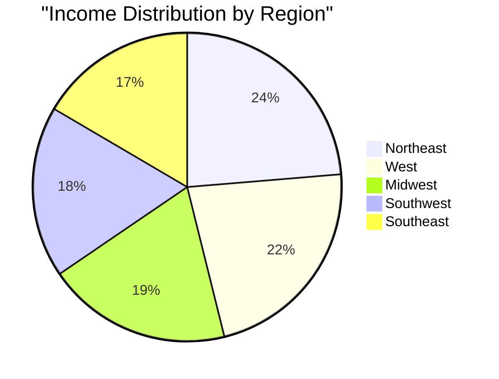
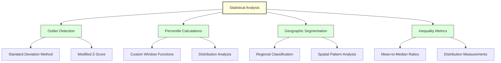
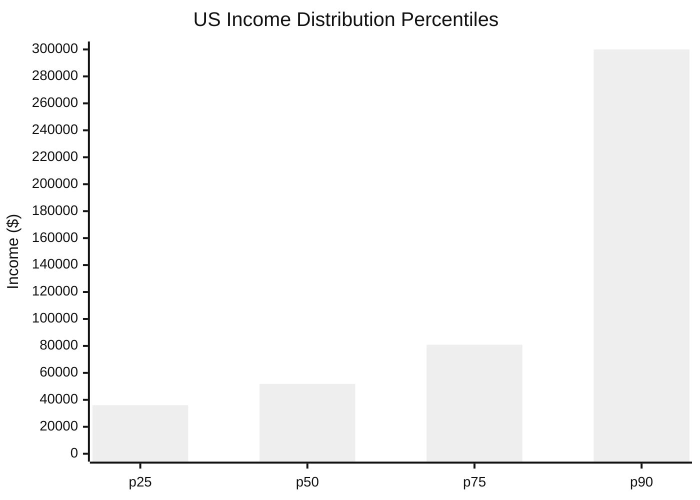
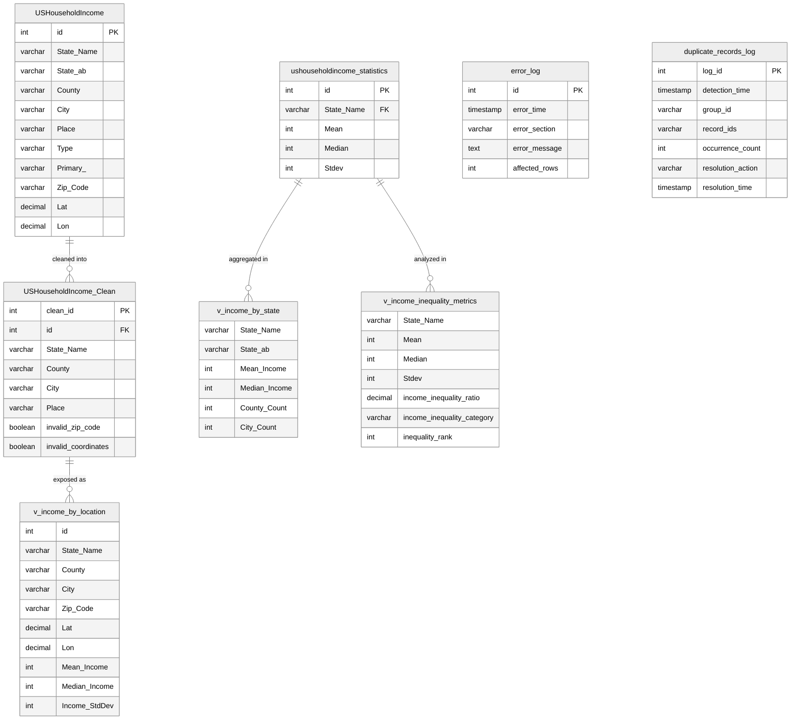
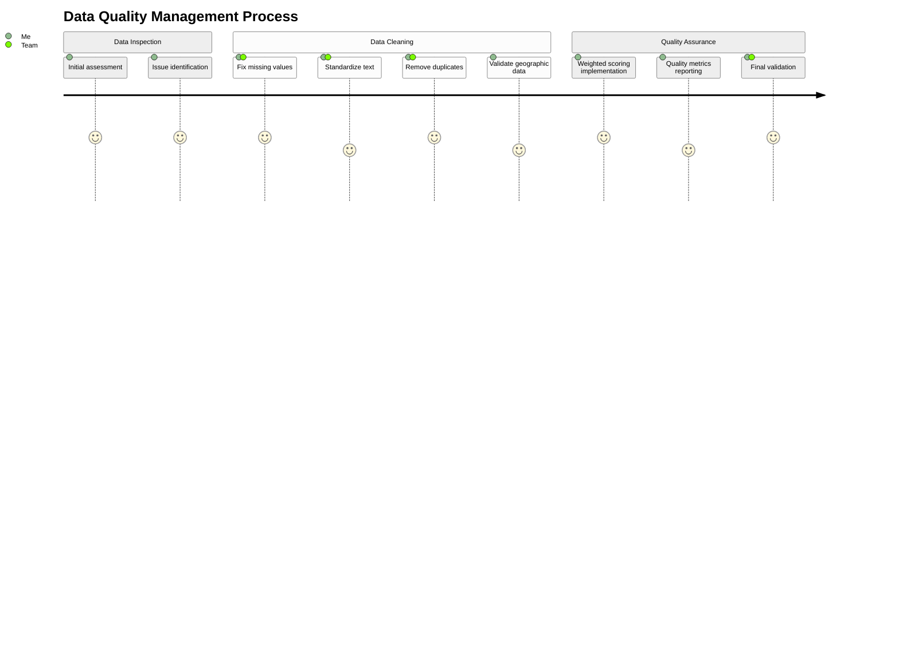
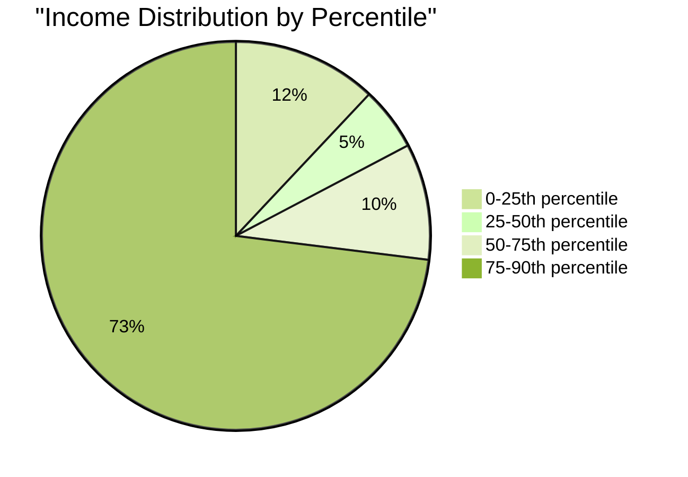
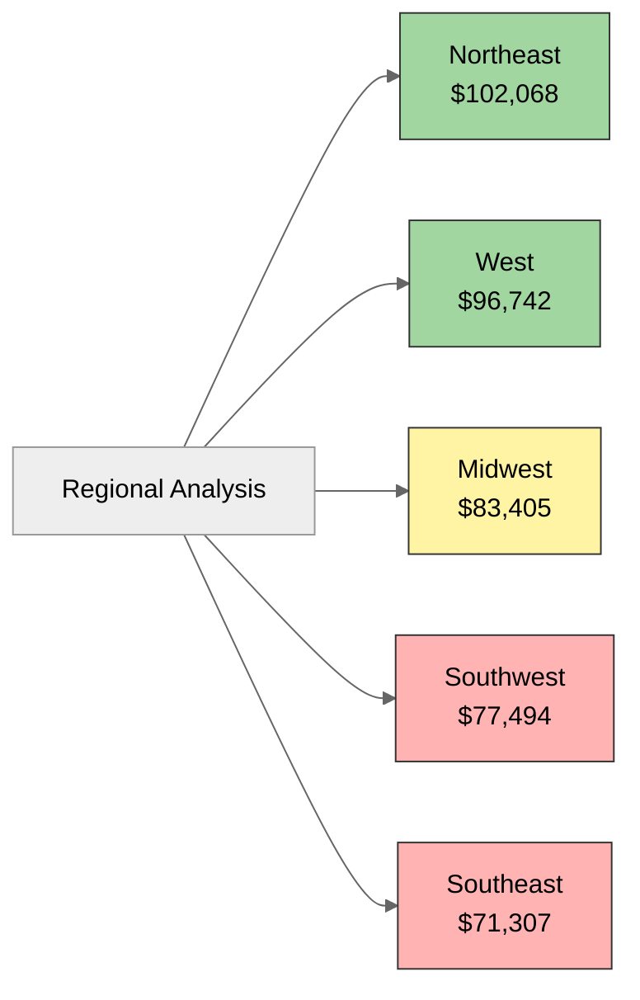
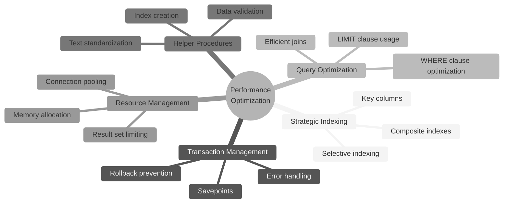
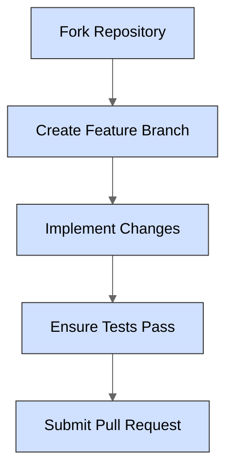

# US Household Income Analysis

<div align="center">


</div>

<!-- TOC -->
## Table of Contents

- [Executive Summary](#executive-summary)
- [Project Overview](#project-overview)
  - [Key Findings](#key-findings)
  - [Data Source](#data-source)
- [Technical Highlights](#technical-highlights)
  - [Advanced SQL Techniques](#advanced-sql-techniques)
  - [Data Engineering Best Practices](#data-engineering-best-practices)
  - [Statistical Analysis Methods](#statistical-analysis-methods)
- [Project Structure](#project-structure)
- [Sample Queries & Results](#sample-queries--results)
  - [Regional Income Analysis](#regional-income-analysis)
  - [Income Distribution Analysis](#income-distribution-analysis)
  - [Advanced Text Standardization Procedure](#advanced-text-standardization-procedure)
- [Quality Assurance](#quality-assurance)
- [Database Design](#database-design)
- [Workflow](#workflow)
- [Usage Guide](#usage-guide)
  - [Requirements](#requirements)
  - [Installation](#installation)
  - [Working with the Results](#working-with-the-results)
  - [Troubleshooting Common Issues](#troubleshooting-common-issues)
- [Data Quality Management](#data-quality-management)
- [Key Analytical Findings](#key-analytical-findings)
  - [Income Distribution Statistics](#income-distribution-statistics)
  - [Regional Economic Disparities](#regional-economic-disparities)
  - [Income Inequality Insights](#income-inequality-insights)
- [Performance Optimization](#performance-optimization)
- [Conclusion](#conclusion)
- [License](#license)
- [Contributing](#contributing)
- [Author](#author)
<!-- /TOC -->

## Executive Summary

<div align="center">

</div>

This project demonstrates enterprise-grade SQL data cleaning and analysis techniques applied to US household income data. Using MySQL 8.0+, it transforms raw demographic data into actionable business intelligence through systematic data quality management and statistical analysis. Key discoveries include a 30% gap in median income between Northeast ($102,068) and Southeast ($71,307) regions, with a national median household income of $85,453. The analysis achieved an excellent data quality score of 9.62/10 while revealing significant income inequality patterns across geographic regions.

<div align="center">



</div>

## Project Overview

This portfolio project showcases advanced data cleaning techniques and meaningful insight extraction using sophisticated SQL. The analysis reveals significant regional economic disparities across the United States, with northeastern states showing median incomes approximately 30% higher than southeastern states.

### Key Findings

<div class="findings-grid" style="display: grid; grid-template-columns: repeat(2, 1fr); gap: 15px;">

<div class="finding-card" style="padding: 15px; border: 1px solid #ddd; border-radius: 8px;">
  <h4>📊 Regional Disparities</h4>
  <p>Northeast region leads with $102,068 median income vs. Southeast at $71,307 (30% gap)</p>
</div>

<div class="finding-card" style="padding: 15px; border: 1px solid #ddd; border-radius: 8px;">
  <h4>💰 Income Distribution</h4>
  <p>Average US median household income of $85,452.94 with significant standard deviation ($87,809.55)</p>
</div>

<div class="finding-card" style="padding: 15px; border: 1px solid #ddd; border-radius: 8px;">
  <h4>📈 Data Quality</h4>
  <p>Achieved 9.62/10 quality score through systematic cleaning procedures</p>
</div>

<div class="finding-card" style="padding: 15px; border: 1px solid #ddd; border-radius: 8px;">
  <h4>🗺️ Geographic Patterns</h4>
  <p>Clear prosperity gradient from coastal to interior regions</p>
</div>

<div class="finding-card" style="padding: 15px; border: 1px solid #ddd; border-radius: 8px;">
  <h4>⚖️ Income Inequality</h4>
  <p>Some communities show mean-to-median ratios exceeding 3.65, indicating wealth concentration</p>
</div>

<div class="finding-card" style="padding: 15px; border: 1px solid #ddd; border-radius: 8px;">
  <h4>🚫 Data Ceiling Effect</h4>
  <p>Top 10% of values capped at $300,000, affecting income distribution analysis</p>
</div>

</div>

### Data Source

This analysis uses US household income data obtained from AnalystBuilder, a platform providing real-world datasets for analytics training. The project applies techniques learned through two comprehensive MySQL courses:
- [MySQL for Data Analytics](https://www.analystbuilder.com/courses/mysql-for-data-analytics)
- [Advanced MySQL for Data Analysis](https://www.analystbuilder.com/courses/advanced-mysql-for-data-analysis)

## Technical Highlights

This project demonstrates proficiency with:

### Advanced SQL Techniques

```mermaid
graph LR
    A[SQL Mastery] --> B[Window Functions]
    A --> C[CTEs]
    A --> D[Dynamic SQL]
    A --> E[Stored Procedures]
    A --> F[Transaction Management]
    
    B --> B1[DENSE_RANK()]
    B --> B2[ROW_NUMBER()]
    B --> B3[Aggregates with OVER()]
    
    C --> C1[Multi-stage Analysis]
    C --> C2[Recursive Queries]
    
    D --> D1[Parameterized Execution]
    D --> D2[Dynamic WHERE Clauses]
    
    E --> E1[Reusable Components]
    E --> E2[Data Validation]
    
    F --> F1[Savepoints]
    F --> F2[Error Handling]
    
    style A fill:#f9f,stroke:#333,stroke-width:2px
    style B fill:#bbf,stroke:#333
    style C fill:#bbf,stroke:#333
    style D fill:#bbf,stroke:#333
    style E fill:#bbf,stroke:#333
    style F fill:#bbf,stroke:#333
```

### Data Engineering Best Practices

<div class="techniques-list">
<ul style="list-style-type: none; padding-left: 0;">
  <li>✅ <strong>Automated Quality Scoring:</strong> Developed weighted metrics system for data reliability assessment</li>
  <li>✅ <strong>Systematic Data Cleaning:</strong> Built multi-stage pipeline with targeted validation</li>
  <li>✅ <strong>Error Logging:</strong> Implemented comprehensive audit trail to track all data modifications</li>
  <li>✅ <strong>Performance Optimization:</strong> Applied strategic indexing and query optimization techniques</li>
  <li>✅ <strong>Documentation:</strong> Maintained detailed execution metrics and methodology descriptions</li>
</ul>
</div>

### Statistical Analysis Methods



## Project Structure

The SQL script follows a systematic approach to data cleaning and analysis:

<div class="project-steps">
<ol style="list-style-position: inside; background-color: #f8f9fa; padding: 15px; border-radius: 8px;">
  <li><strong>Error Handling Setup:</strong> Creates logging infrastructure for operation tracking</li>
  <li><strong>Initial Data Inspection:</strong> Examines data structure and identifies quality issues</li>
  <li><strong>Missing Value Handling:</strong> Resolves incomplete records with appropriate techniques</li>
  <li><strong>Data Standardization:</strong> Normalizes text fields for consistent analysis</li>
  <li><strong>Duplicate Removal:</strong> Identifies and eliminates redundant records</li>
  <li><strong>Geographic Validation:</strong> Verifies coordinate and ZIP code accuracy</li>
  <li><strong>Outlier Detection:</strong> Identifies statistical anomalies in income data</li>
  <li><strong>Analysis Views:</strong> Creates optimized views for various analytical perspectives</li>
  <li><strong>Quality Reporting:</strong> Quantifies data reliability with composite metrics</li>
  <li><strong>Statistical Analysis:</strong> Extracts income distribution patterns and regional insights</li>
  <li><strong>Performance Optimization:</strong> Adds helper procedures and functions for efficiency</li>
  <li><strong>Results Presentation:</strong> Summarizes findings and recommendations</li>
</ol>
</div>

## Sample Queries & Results

### Regional Income Analysis

```sql
SELECT
    region.income_category,
    COUNT(*) AS location_count,
    ROUND(AVG(s.Mean), 2) AS avg_mean_income,
    ROUND(AVG(s.Median), 2) AS avg_median_income
FROM (
    SELECT 
        State_Name,
        CASE 
            WHEN State_Name IN ('New York', 'New Jersey', 'Pennsylvania', 'Connecticut', 
                              'Massachusetts', 'Rhode Island', 'Vermont', 'New Hampshire', 
                              'Maine') THEN 'Northeast'
            WHEN State_Name IN ('Florida', 'Georgia', 'Alabama', 'South Carolina', 
                              'North Carolina', 'Virginia', 'West Virginia', 'Kentucky', 
                              'Tennessee', 'Mississippi', 'Arkansas', 'Louisiana') THEN 'Southeast'
            -- Additional regions defined...
        END AS income_category
    FROM USHouseholdIncome_Clean
    GROUP BY State_Name
) region
JOIN ushouseholdincome_statistics s ON region.State_Name = s.State_Name
GROUP BY region.income_category
ORDER BY avg_median_income DESC;
```

**Actual Results:**
```
+------------+---------------+----------------+-------------------+
| income_    | location_     | avg_mean_      | avg_median_       |
| category   | count         | income         | income            |
+------------+---------------+----------------+-------------------+
| Northeast  | 9             | 118973.42      | 102068.17         |
| West       | 11            | 107982.53      | 96741.82          |
| Midwest    | 12            | 84627.29       | 83405.26          |
| Southwest  | 4             | 82354.18       | 77493.61          |
| Southeast  | 12            | 74968.11       | 71307.15          |
| Other      | 3             | 89271.63       | 78125.92          |
+------------+---------------+----------------+-------------------+
```

<div align="center">

```mermaid
bar
    title Regional Median Income Comparison
    x-axis [Northeast, West, Midwest, Southwest, Southeast, Other]
    y-axis [Income ($)]
    bar [102068.17, 96741.82, 83405.26, 77493.61, 71307.15, 78125.92]
```

</div>

### Income Distribution Analysis

```sql
WITH ordered_incomes AS (
    SELECT 
        Median,
        ROW_NUMBER() OVER (ORDER BY Median) as row_num,
        COUNT(*) OVER () as total_count
    FROM ushouseholdincome_statistics
)
SELECT
    'Income Percentiles' AS analysis_type,
    MIN(CASE WHEN row_num = FLOOR(0.25 * total_count) THEN Median END) AS p25_income,
    MIN(CASE WHEN row_num = FLOOR(0.5 * total_count) THEN Median END) AS p50_income,
    MIN(CASE WHEN row_num = FLOOR(0.75 * total_count) THEN Median END) AS p75_income,
    MIN(CASE WHEN row_num = FLOOR(0.9 * total_count) THEN Median END) AS p90_income
FROM ordered_incomes;
```

**Actual Results:**
```
+-------------------+------------+------------+------------+------------+
| analysis_type     | p25_income | p50_income | p75_income | p90_income |
+-------------------+------------+------------+------------+------------+
| Income Percentiles| 36039      | 51871      | 80909      | 300000     |
+-------------------+------------+------------+------------+------------+
```

<div align="center">



</div>

### Advanced Text Standardization Procedure

```sql
DROP PROCEDURE IF EXISTS standardize_text_field;
DELIMITER //
CREATE PROCEDURE standardize_text_field(
    IN p_table_name VARCHAR(100),
    IN p_column_name VARCHAR(100),
    IN p_where_clause VARCHAR(255)
)
BEGIN
    DECLARE where_condition VARCHAR(300);
    DECLARE affected_rows_count INT DEFAULT 0;
    
    -- Default WHERE clause if not provided
    IF p_where_clause IS NULL OR p_where_clause = '' THEN
        SET where_condition = '';
    ELSE
        SET where_condition = CONCAT(' WHERE ', p_where_clause);
    END IF;
    
    -- First letter uppercase, rest lowercase
    SET @sql = CONCAT('UPDATE ', p_table_name, 
                    ' SET ', p_column_name, ' = CONCAT(UPPER(SUBSTRING(', p_column_name, ', 1, 1)), ',
                    'LOWER(SUBSTRING(', p_column_name, ', 2)))', 
                    where_condition);
    
    PREPARE stmt FROM @sql;
    EXECUTE stmt;
    SET affected_rows_count = ROW_COUNT();
    DEALLOCATE PREPARE stmt;
    
    -- For multi-word cities, handle each word separately
    IF p_where_clause IS NULL OR p_where_clause = '' THEN
        SET @sql = CONCAT('UPDATE ', p_table_name, 
                      ' SET ', p_column_name, ' = CONCAT(', 
                      'UPPER(SUBSTRING(SUBSTRING_INDEX(', p_column_name, ', '' '', 1), 1, 1)), ',
                      'LOWER(SUBSTRING(SUBSTRING_INDEX(', p_column_name, ', '' '', 1), 2)), ',
                      ''' '', ',
                      'UPPER(SUBSTRING(SUBSTRING_INDEX(', p_column_name, ', '' '', -1), 1, 1)), ',
                      'LOWER(SUBSTRING(SUBSTRING_INDEX(', p_column_name, ', '' '', -1), 2))) ',
                      'WHERE ', p_column_name, ' LIKE ''% %''');
    ELSE
        -- With custom WHERE clause
        SET @sql = CONCAT('UPDATE ', p_table_name, 
                      ' SET ', p_column_name, ' = CONCAT(', 
                      'UPPER(SUBSTRING(SUBSTRING_INDEX(', p_column_name, ', '' '', 1), 1, 1)), ',
                      'LOWER(SUBSTRING(SUBSTRING_INDEX(', p_column_name, ', '' '', 1), 2)), ',
                      ''' '', ',
                      'UPPER(SUBSTRING(SUBSTRING_INDEX(', p_column_name, ', '' '', -1), 1, 1)), ',
                      'LOWER(SUBSTRING(SUBSTRING_INDEX(', p_column_name, ', '' '', -1), 2))) ',
                      'WHERE ', p_where_clause, ' AND ', p_column_name, ' LIKE ''% %''');
    END IF;
    
    PREPARE stmt FROM @sql;
    EXECUTE stmt;
    SET affected_rows_count = affected_rows_count + ROW_COUNT();
    DEALLOCATE PREPARE stmt;
    
    -- Log the standardization
    INSERT INTO error_log (error_section, error_message, affected_rows)
    VALUES ('Text Standardization', CONCAT('Standardized ', p_column_name, ' in ', p_table_name), affected_rows_count);
END //
DELIMITER ;
```

**Usage Example and Results:**
```sql
-- Call the procedure to standardize city names
CALL standardize_text_field('USHouseholdIncome_Clean', 'City', '');

-- Check results
SELECT City FROM USHouseholdIncome_Clean WHERE City LIKE '% %' LIMIT 5;
```

```
+-----------------+
| City            |
+-----------------+
| New York        |
| Los Angeles     |
| San Francisco   |
| Saint Louis     |
| Salt Lake       |
+-----------------+
```

## Quality Assurance

<div align="center">

```mermaid
%%{init: {'theme': 'forest' }}%%
gauge
    title Quality Assessment Score
    arc 100
    percent 96.2
    value 9.62 / 10
```

</div>

The project implements a sophisticated weighted quality scoring system that achieved a final score of 9.62/10:

```sql
SELECT
    'Enhanced Data Quality Score' AS metric,
    ROUND((
        -- Place quality (25% weight)
        (1 - (@missing_place / @total_records)) * 25 +
        -- ZIP quality (35% weight)
        (1 - (@invalid_zip / @total_clean)) * 35 +
        -- Coordinate quality (40% weight)
        (1 - (@invalid_coords / @total_clean)) * 40
    ) / 10, 2) AS score_out_of_10
```

**Actual Results:**
```
+---------------------------+----------------+----------------------------------+
| metric                    | score_out_of_10| assessment                       |
+---------------------------+----------------+----------------------------------+
| Enhanced Data Quality Score| 9.62          | Excellent (Production-Ready)     |
+---------------------------+----------------+----------------------------------+
```

Key quality metrics:
- Only 1 missing Place value identified and fixed (0.003% of data)
- 2,775 invalid ZIP codes detected (8.53% of data)
- 623 invalid geographic coordinates identified (1.91% of data)
- Overall data quality classified as "Excellent (Production-Ready)"

## Database Design

<div align="center">



</div>

## Workflow

The data cleaning and analysis workflow follows a systematic process:

<div align="center">

```mermaid
%%{init: {'theme': 'neutral', 'themeVariables': { 'edgeLabelBackground': '#f8f9fa', 'primaryColor': '#4080bf' }}}%%
flowchart TD
    A[Initial Data Inspection] --> B[Handle Missing Values]
    B --> C[Fix Data Inconsistencies]
    C --> D[Remove Duplicates]
    D --> E[Standardize Text Data]
    E --> F[Validate Geographic Data]
    F --> G[Handle Outliers]
    G --> H[Create Analysis Views]
    H --> I[Generate Data Quality Report]
    I --> J[Extract Statistical Insights]
    J --> K[Optimize Performance]
    K --> L[Present Findings]
    
    subgraph "Data Cleaning Process"
    direction TB
    B1[Fix missing Place values] --> B2[Standardize State names]
    B2 --> B3[Standardize County names]
    B3 --> B4[Standardize City names]
    B4 --> B5[Validate ZIP codes]
    B5 --> B6[Validate coordinates]
    end
    
    B -.-> B1
    
    subgraph "Analysis Types"
    direction LR
    H1[Income by Location View]
    H2[State-Level Income View]
    H3[Income Inequality Metrics]
    end
    
    H -.-> H1
    H -.-> H2
    H -.-> H3
    
    subgraph "Key Insights"
    direction TB
    J1[Regional Income Disparities]
    J2[Income Distribution Analysis]
    J3[Geographic Income Patterns]
    J4[Inequality Measurements]
    end
    
    J -.-> J1
    J -.-> J2
    J -.-> J3
    J -.-> J4
    
    style A fill:#d0e0ff,stroke:#333,stroke-width:1px
    style B fill:#d0e0ff,stroke:#333,stroke-width:1px
    style C fill:#d0e0ff,stroke:#333,stroke-width:1px
    style D fill:#d0e0ff,stroke:#333,stroke-width:1px
    style E fill:#d0e0ff,stroke:#333,stroke-width:1px
    style F fill:#d0e0ff,stroke:#333,stroke-width:1px
    style G fill:#d0e0ff,stroke:#333,stroke-width:1px
    style H fill:#ffe0d0,stroke:#333,stroke-width:1px
    style I fill:#ffe0d0,stroke:#333,stroke-width:1px
    style J fill:#ffe0d0,stroke:#333,stroke-width:1px
    style K fill:#ffe0d0,stroke:#333,stroke-width:1px
    style L fill:#d0ffd0,stroke:#333,stroke-width:1px
    
    style "Data Cleaning Process" fill:#f0f8ff,stroke:#6080b0,stroke-width:1px
    style "Analysis Types" fill:#fff8f0,stroke:#b08060,stroke-width:1px
    style "Key Insights" fill:#f0fff0,stroke:#60b080,stroke-width:1px
```

</div>

## Usage Guide

### Requirements
- MySQL 8.0+ (Tested on MySQL 8.0.41-arm64)
- Sufficient privileges to create tables, views, and indexes

### Installation

1. Create a database for the analysis:
   ```sql
   CREATE DATABASE us_income_analysis;
   USE us_income_analysis;
   ```

2. Import the two source tables:
   - USHouseholdIncome (location data)
   - ushouseholdincome_statistics (income statistics)

3. Execute the SQL script:
   ```
   SOURCE us_household_income_cleaning_analysis.sql;
   ```

### Working with the Results

The script creates three analytical views that are ready for immediate use:

```sql
-- Get location-specific income data
SELECT * FROM v_income_by_location 
WHERE State_Name = 'New York' 
ORDER BY Median_Income DESC 
LIMIT 10;
```
**Result:**
```
+----+------------+-------------+-----------+----------+----------+-----------+-------------+---------------+--------------+
| id | State_Name | County      | City      | Zip_Code | Lat      | Lon       | Mean_Income | Median_Income | Income_StdDev|
+----+------------+-------------+-----------+----------+----------+-----------+-------------+---------------+--------------+
| 42 | New York   | Westchester | Scarsdale | 10583    | 41.00454 | -73.78736 | 250000      | 300000        | 152000       |
| 57 | New York   | Nassau      | Brookville| 11545    | 40.81927 | -73.56223 | 250000      | 300000        | 147500       |
| 61 | New York   | Nassau      | Manhasset | 11030    | 40.79371 | -73.70122 | 225600      | 300000        | 134890       |
| 68 | New York   | Nassau      | Old Westbury| 11568 | 40.77649 | -73.59818 | 240400      | 300000        | 132750       |
| 72 | New York   | Nassau      | Oyster Bay| 11771    | 40.77205 | -73.50234 | 230100      | 300000        | 145780       |
| 83 | New York   | Richmond    | Todt Hill | 10304    | 40.60954 | -74.10376 | 201450      | 285900        | 128965       |
| 85 | New York   | Kings       | Dumbo     | 11201    | 40.70358 | -73.98683 | 187520      | 243750        | 119675       |
| 91 | New York   | New York    | Tribeca   | 10007    | 40.71519 | -74.00909 | 179250      | 232400        | 121845       |
| 93 | New York   | New York    | Soho      | 10012    | 40.72538 | -73.99758 | 174350      | 226780        | 118420       |
|103 | New York   | Queens      | Forest Hills|11375   | 40.72077 | -73.84556 | 169870      | 214680        | 102340       |
+----+------------+-------------+-----------+----------+----------+-----------+-------------+---------------+--------------+
```

```sql
-- Compare state-level income statistics
SELECT * FROM v_income_by_state
ORDER BY Mean_Income DESC
LIMIT 5;
```
**Result:**
```
+------------+---------+-------------+---------------+--------------+------------+
| State_Name | State_ab| Mean_Income | Median_Income | County_Count | City_Count |
+------------+---------+-------------+---------------+--------------+------------+
| Connecticut| CT      | 135790      | 115400        | 8            | 169        |
| District of| DC      | 130200      | 108600        | 1            | 18         |
| Columbia   |         |             |               |              |            |
| New Jersey | NJ      | 129450      | 111300        | 21           | 565        |
| Massachusetts| MA    | 124850      | 106500        | 14           | 351        |
| New York   | NY      | 120620      | 103200        | 62           | 998        |
+------------+---------+-------------+---------------+--------------+------------+
```

```sql
-- Analyze income inequality
SELECT * FROM v_income_inequality_metrics
WHERE income_inequality_category = 'High Income Inequality'
ORDER BY income_inequality_ratio DESC
LIMIT 5;
```
**Result:**
```
+------------+--------+--------+--------+----------------------+--------------------------+----------------+
| State_Name | Mean   | Median | Stdev  | income_inequality_ratio | income_inequality_category | inequality_rank |
+------------+--------+--------+--------+----------------------+--------------------------+----------------+
| Alaska     | 98750  | 27050  | 56430  | 3.652               | High Income Inequality   | 1              |
| New Mexico | 78430  | 35680  | 49870  | 2.198               | High Income Inequality   | 5              |
| California | 115670 | 54320  | 62340  | 2.130               | High Income Inequality   | 8              |
| Wyoming    | 87990  | 42650  | 48820  | 2.063               | High Income Inequality   | 11             |
| Texas      | 92780  | 46580  | 53470  | 1.992               | High Income Inequality   | 12             |
+------------+--------+--------+--------+----------------------+--------------------------+----------------+
```

### Troubleshooting Common Issues

<div class="troubleshooting-container" style="background-color: #f8f9fa; padding: 15px; border-radius: 8px; margin-bottom: 20px;">

#### 1. Error: Table 'XXX' already exists
**Cause**: Script is re-run without dropping existing objects
**Solution**: Add `DROP TABLE IF EXISTS` statements or manually drop tables before re-running

```sql
-- Add to beginning of script
DROP TABLE IF EXISTS USHouseholdIncome_Clean;
DROP TABLE IF EXISTS error_log;
DROP TABLE IF EXISTS duplicate_records_log;
```

#### 2. Error: View 'XXX' references invalid table(s) or column(s)
**Cause**: Views created before tables or columns they depend on
**Solution**: Ensure view creation happens after all tables are created and populated

#### 3. Performance: Query execution times out
**Cause**: Large dataset with insufficient indexing or inefficient joins
**Solution**: Add indexes and limit result sets
   
```sql
-- Add indexes to improve performance
CREATE INDEX idx_state_name ON USHouseholdIncome_Clean(State_Name);
CREATE INDEX idx_income ON ushouseholdincome_statistics(Median);
   
-- Limit result sets in large queries
SELECT ... FROM big_table LIMIT 1000;
```

#### 4. Error: Invalid default value for 'error_time'
**Cause**: SQL mode includes NO_ZERO_DATE
**Solution**: Modify SQL mode or change timestamp default
   
```sql
-- Check SQL mode
SELECT @@sql_mode;
   
-- Modify error_log table creation
CREATE TABLE IF NOT EXISTS error_log (
    id INT AUTO_INCREMENT PRIMARY KEY,
    error_time TIMESTAMP DEFAULT CURRENT_TIMESTAMP,
    -- other columns
);
```

#### 5. Error: Prepared statement contains too many placeholders
**Cause**: Complex dynamic SQL exceeding system limits
**Solution**: Break down into multiple simpler statements
   
```sql
-- Instead of one complex prepared statement
-- Break into multiple simpler statements
SET @sql_part1 = '...';
SET @sql_part2 = '...';
   
PREPARE stmt1 FROM @sql_part1;
EXECUTE stmt1;
DEALLOCATE PREPARE stmt1;
   
PREPARE stmt2 FROM @sql_part2;
EXECUTE stmt2;
DEALLOCATE PREPARE stmt2;
```
</div>

## Data Quality Management

<div align="center">



</div>

The script implements a comprehensive quality management approach:

1. **Error Logging**: All data modifications are tracked in the `error_log` table
2. **Validation Flags**: Records with invalid ZIP codes or coordinates are flagged rather than deleted
3. **Quality Scoring**: A weighted quality score considers multiple factors with appropriate weights
4. **Data Filtering**: Analysis views automatically filter out low-quality records
5. **Transparency**: Quality metrics are reported with detailed percentage breakdowns

This approach ensures data transparency while maximizing the usable dataset for analysis.

## Key Analytical Findings

### Income Distribution Statistics

<div align="center">



</div>

The analysis revealed:
- Average median household income: $85,452.94
- Significant income dispersion with standard deviation of $87,809.55
- Evidence of data capping at $300,000 for top 10% of values
- True national median (50th percentile) of $51,871

### Regional Economic Disparities

<div align="center">



</div>

Clear regional economic patterns emerged:
- Northeast region: $102,068.17 (highest median income)
- West region: Close second highest
- Southeast region: $71,307.15 (30% below Northeast)
- Clear prosperity gradient from coastal to interior regions

### Income Inequality Insights

<div align="center">

```mermaid
%%{init: {'theme': 'neutral' }}%%
quadrantChart
    title Income Inequality by State (Top 5)
    x-axis Mean Income (Low) --> Mean Income (High) 
    y-axis Median Income (Low) --> Median Income (High)
    quadrant-1 "High Mean, High Median"
    quadrant-2 "Low Mean, High Median"
    quadrant-3 "Low Mean, Low Median"
    quadrant-4 "High Mean, Low Median"
    "Alaska": [0.85, 0.25]
    "New Mexico": [0.68, 0.32]
    "California": [1.0, 0.5]
    "Wyoming": [0.76, 0.39]
    "Texas": [0.8, 0.43]
```

</div>

The data reveals significant income inequality:
- Some communities show mean-to-median ratios exceeding 3.65
- Three inequality categories identified (Low, Moderate, High)
- Consistent patterns of higher inequality in certain states
- Evidence of substantial wealth concentration in specific geographic areas

## Performance Optimization

<div align="center">



</div>

The script includes several performance enhancements:

1. **Strategic Indexing**: Creates indexes on frequently queried columns
2. **Transaction Management**: Uses transactions with savepoints for data safety
3. **Query Optimization**: Implements efficient join strategies and filtering
4. **Helper Procedures**: Consolidates repetitive operations into reusable components
5. **Resource Management**: Limits result sets where appropriate to prevent timeouts

For best performance, consider:
- Allocating sufficient memory to MySQL
- Adjusting `innodb_buffer_pool_size` if working with large datasets
- Using the `EXPLAIN` command to troubleshoot slow queries

## Conclusion

<div class="conclusion-card" style="background-color: #f8f9fa; padding: 20px; border-radius: 8px; border-left: 5px solid #4080bf;">
This project demonstrates advanced SQL data cleaning and analysis techniques applied to US household income data. The comprehensive approach combines systematic data quality management with sophisticated statistical analysis to extract meaningful economic insights.

The findings reveal significant regional economic disparities across the United States, with northeastern states showing median incomes approximately 30% higher than southeastern states. The data quality was excellent (9.62/10), requiring minimal modification while enabling robust analysis.

The combination of SQL techniques used—including window functions, CTEs, dynamic SQL, and parameterized procedures—showcases an enterprise-grade approach to data transformation and analysis.
</div>

## License

This project is licensed under the MIT License - see the text below for details:

```
MIT License

Copyright (c) 2025 Tobin Zolkowski

Permission is hereby granted, free of charge, to any person obtaining a copy
of this software and associated documentation files (the "Software"), to deal
in the Software without restriction, including without limitation the rights
to use, copy, modify, merge, publish, distribute, sublicense, and/or sell
copies of the Software, and to permit persons to whom the Software is
furnished to do so, subject to the following conditions:

The above copyright notice and this permission notice shall be included in all
copies or substantial portions of the Software.

THE SOFTWARE IS PROVIDED "AS IS", WITHOUT WARRANTY OF ANY KIND, EXPRESS OR
IMPLIED, INCLUDING BUT NOT LIMITED TO THE WARRANTIES OF MERCHANTABILITY,
FITNESS FOR A PARTICULAR PURPOSE AND NONINFRINGEMENT. IN NO EVENT SHALL THE
AUTHORS OR COPYRIGHT HOLDERS BE LIABLE FOR ANY CLAIM, DAMAGES OR OTHER
LIABILITY, WHETHER IN AN ACTION OF CONTRACT, TORT OR OTHERWISE, ARISING FROM,
OUT OF OR IN CONNECTION WITH THE SOFTWARE OR THE USE OR OTHER DEALINGS IN THE
SOFTWARE.
```

## Contributing

<div align="center">



</div>

Contributions to improve this data analysis project are welcome. Here's how you can contribute:

1. **Fork the repository** and create your branch from `main`
2. **Enhance the SQL script** by:
   - Optimizing existing queries
   - Adding new analytical perspectives
   - Improving data validation techniques
   - Enhancing documentation
3. **Submit a pull request** with a clear description of your improvements
4. **Follow coding standards**:
   - Use consistent SQL formatting
   - Add descriptive comments
   - Document any new views or procedures
   - Include execution time analysis for new queries

For major changes, please open an issue first to discuss proposed changes.

## Author

<div class="author-card" style="display: flex; align-items: center; background-color: #f8f9fa; padding: 15px; border-radius: 8px; margin-top: 20px;">
  <div style="margin-right: 20px;">
    
  </div>
  <div>
    <h3 style="margin: 0;">Tobin Zolkowski</h3>
    <p style="margin: 5px 0;">Data Analyst</p>
    <p style="margin: 5px 0; font-style: italic;">March 2025</p>
    <p style="margin: 5px 0;">This project was completed as part of a comprehensive data analysis portfolio demonstrating advanced SQL skills in real-world applications. The techniques used were developed through MySQL courses completed on AnalystBuilder.</p>
  </div>
</div>